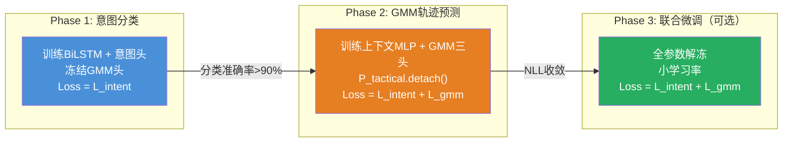

# 双层意图条件化GMM轨迹预测网络 — 设计文档

> 本文档完整描述"机动识别与轨迹预测"模块的技术方案，涵盖问题定义、方法设计、网络架构、数据流、损失函数与创新点。
>
> 代码实现：[intent_gmm_predictor.py](file:///data/uavlab/maneuverable-target/omni_drones/learning/predictor/intent_gmm_predictor.py) · [losses.py](file:///data/uavlab/maneuverable-target/omni_drones/learning/predictor/losses.py) · [mvs.py](file:///data/uavlab/maneuverable-target/omni_drones/learning/predictor/mvs.py)

---

## 一、问题定义

### 1.1 场景

三对一（3v1）多无人机拦截对抗：3架追捕方四旋翼协同拦截1架高机动逃逸目标四旋翼。

```
     P₁ ╲
          ╲        ┌─────────┐
     P₂ ───→ 拦截 │ 目标 T   │ ──→ 逃逸 / 突防守区
          ╱        └─────────┘
     P₃ ╱
```

### 1.2 核心难点

追捕方需要预测目标的**未来运动**来提前规划拦截路径。但高机动目标存在以下挑战：

| 难点 | 表现 | 后果 |
|------|------|------|
| **机动突变** | 目标在飞行中突然变向（左转→右转、直飞→俯冲） | 基于当前速度的线性外推立刻失效 |
| **意图不可观测** | 追捕方只能观测目标的位置和速度，无法直接获取加速度或决策 | 预测只能基于运动学历史推断 |
| **不确定性随态势变化** | 目标稳定直飞时可预测性高；频繁变向规避时可预测性低 | 预测需要自适应地表达"多确定"或"多不确定" |
| **多追捕方协同** | 3架追捕方需要根据预测的不确定性调整编队展开策略 | 预测输出必须编码不确定性信息，而不仅仅是一个点估计 |

### 1.3 现有方法的不足

| 方法 | 局限 |
|------|------|
| 卡尔曼滤波 / 线性外推 | 只能处理匀速/匀加速，无法预测机动切换 |
| 纯RNN轨迹预测 | 输出单条轨迹（点估计），不表达不确定性 |
| 标准GMM（EM离线拟合） | 参数固定，无法根据对抗态势动态调整 |
| 纯MDN（混合密度网络） | 不区分机动类型，无法利用意图信息条件化预测 |

---

## 二、方法概述

### 2.1 一句话总结

> 提出**双层意图条件化高斯混合模型（Dual-Intent Conditioned GMM）**：第一层（战术意图）识别目标当前机动类型，第二层（机动变异度）量化行为稳定性，两层信息通过**上下文融合**和**物理调制**机制共同条件化一个GMM轨迹预测器，使输出的多模态预测分布自适应地反映对抗态势下的预测不确定性。

### 2.2 方法全貌

```
┌─────────────────────────────────────────────────────────────────────────┐
│                          整体信息流                                      │
│                                                                         │
│  ┌───────────────┐                                                     │
│  │ 观测历史       │  target(pos,vel) + 3×pursuer(pos,vel)              │
│  │ T_obs × 24维  │  × T_obs 步                                        │
│  └───────┬───────┘                                                     │
│          │                                                              │
│          ▼                                                              │
│  ┌───────────────┐                                                     │
│  │  共享BiLSTM   │  时序编码器                                          │
│  │  编码器       │  提取运动学时序特征                                    │
│  └───────┬───────┘                                                     │
│          │ h (256维)                                                    │
│     ┌────┴────────────────┐                                            │
│     │                      │                                            │
│     ▼                      ▼                                            │
│  ┌──────────┐     ┌────────────────┐                                   │
│  │ 意图分类  │     │ 上下文融合      │                                   │
│  │ 头       │     │ Z=MLP(h,P,MVS) │                                   │
│  │ →10类概率│     └───────┬────────┘                                   │
│  └────┬─────┘             │                                            │
│       │ P_tactical        │ Z (128维)                                  │
│       │                   │                                            │
│       │            ┌──────┴───────────────────┐                        │
│       │            │         │                 │                        │
│       │            ▼         ▼                 ▼                        │
│       │     ┌─────────┐ ┌─────────┐    ┌───────────┐                  │
│       │     │ 权重头   │ │ 均值头   │    │ 方差头     │                  │
│       │     │ → π     │ │ → μ     │    │ → σ²      │                  │
│       │     └────┬────┘ └────┬────┘    └─────┬─────┘                  │
│       │          │           │               │                         │
│  ┌────┴───┐  ┌──┴───┐       │          ┌────┴──────┐                  │
│  │ MVS    │  │ 温度  │       │          │ 方差膨胀   │                  │
│  │ 规则   │  │ 缩放  │       │          │           │                  │
│  │ 计算   │→ │ τ=1+  │       │          │ σ²×(1+    │                  │
│  │        │  │ α·MVS │       │          │ β·MVS)    │                  │
│  └────────┘  └──┬───┘       │          └─────┬─────┘                  │
│                 │            │                │                         │
│                 ▼            ▼                ▼                         │
│            ┌─────────────────────────────────────┐                     │
│            │          GMM 输出分布                 │                     │
│            │  P(x) = Σ πₖ · N(μₖ, σ²ₖ)          │                     │
│            │                                      │                     │
│            │  + 混合均值 μ_mix                     │                     │
│            │  + 混合方差 σ²_mix                    │                     │
│            └──────────────┬──────────────────────┘                     │
│                           │                                            │
│                           ▼                                            │
│                  ┌─────────────────┐                                   │
│                  │ 传给追捕方Actor  │                                   │
│                  │ 作为RL观测的一部分│                                   │
│                  └─────────────────┘                                   │
└─────────────────────────────────────────────────────────────────────────┘
```

---

## 三、双层意图设计

### 3.1 第一层：战术意图（Tactical Intent）

**定义**：目标**当前时刻**正在执行的机动类型。

通过对目标的控制加速度指令 $\mathbf{a}_{cmd}$ 在速度方向坐标系下分解为侧向分量 $a_{lat}$ 和垂向分量 $a_{lon}$，再经阈值判定得到 10 类离散标签：

```
             垂向 (lon)
                ↑
   Left-Climb   |   Right-Climb
        ╲       |       ╱
         ╲  Climb  ╱
          ╲   |   ╱
Left-Turn ──|─────|── Right-Turn    → 侧向 (lat)
          ╱   |   ╲
         ╱  Dive   ╲
        ╱       |       ╲
   Left-Dive    |    Right-Dive
```

```python
INTENT_LABELS = [
    "Straight",      # 0    a_lat ≈ 0,  a_lon ≈ 0
    "Left-Turn",     # 1    a_lat > ε
    "Right-Turn",    # 2    a_lat < -ε
    "Climb",         # 3    a_lon > ε
    "Dive",          # 4    a_lon < -ε
    "Left-Climb",    # 5    a_lat > ε,  a_lon > ε
    "Left-Dive",     # 6    a_lat > ε,  a_lon < -ε
    "Right-Climb",   # 7    a_lat < -ε, a_lon > ε
    "Right-Dive",    # 8    a_lat < -ε, a_lon < -ε
    "Hover",         # 9    ‖v‖ < v_threshold (四旋翼特有)
]
```

**坐标系选择**：速度方向坐标系（Frenet-Serret），低速时回退为Hover标签。

这样保证了**标签一致性**——同一种物理机动（如右转），无论目标在空间中的绝对位置如何，都会得到相同的标签。

**标注方式**：
- **训练时**：用 $\mathbf{a}_{cmd}$（APF输出的控制指令）标注，反映目标的真实意图
- **推理时**：网络从速度差分推断意图（追捕方无法观测到 $\mathbf{a}_{cmd}$）

### 3.2 第二层：机动变异度（Maneuver Variability Score, MVS）

**定义**：量化目标**近期行为的统计不稳定性**，不赋予语义标签。

$$\text{MVS} = 0.6 \times H_{norm} + 0.4 \times R_{switch}$$

其中：
- $H_{norm}$：最近 $W$ 步战术意图序列的归一化分布熵
- $R_{switch}$：意图切换频率（相邻步意图不同的比例）

| MVS值 | 行为特征 | 对预测的含义 |
|-------|---------|-------------|
| ≈ 0 | 意图稳定（如持续直飞或持续右转） | 未来轨迹高度可预测 → 预测分布应集中 |
| ≈ 1 | 意图频繁切换（左转→右转→爬升→...） | 未来轨迹高度不确定 → 预测分布应展开 |

**关键设计决策：MVS不等于"逃逸 vs 突防"**

```
反例1：目标稳定右转逃逸 → MVS低 → 虽然在逃逸，但轨迹可预测
反例2：目标朝守区冲但频繁微调 → MVS高 → 虽然在突防，但路线不稳
```

MVS只回答"行为有多不稳定"，不回答"在逃还是在冲"。这使得调制机制更通用、更严谨。

**实现方式**：基于规则计算（不参与神经网络训练），代码见 [mvs.py](file:///data/uavlab/maneuverable-target/omni_drones/learning/predictor/mvs.py)。

---

## 四、网络架构详解

### 4.1 总体参数

| 参数 | 默认值 | 说明 |
|------|--------|------|
| `obs_dim` | 24 | 每帧观测维度 |
| `n_intents` | 10 | 意图类别数 |
| `n_components` (K) | 3 | GMM分量数 |
| `pred_horizon` (T) | 5 | 预测步数 |
| `hidden_dim` | 128 | LSTM每个方向的隐藏维度 |
| `lstm_layers` | 2 | LSTM层数 |
| `alpha` (α) | 2.0 | 温度缩放系数 |
| `beta` (β) | 1.5 | 方差膨胀系数 |
| **总参数量** | **632,871** | — |

### 4.2 模块一：共享BiLSTM编码器

```
输入: obs_history [B, T_obs, 24]
       │
       ▼
  ┌───────────────────────────────────────┐
  │          nn.LSTM                       │
  │  input_size  = 24                      │
  │  hidden_size = 128                     │
  │  num_layers  = 2                       │
  │  bidirectional = True                  │
  │  dropout = 0.1 (层间)                  │
  └───────────────┬───────────────────────┘
                  │
                  ▼
  lstm_out: [B, T_obs, 256]  (双向拼接: 128×2)
                  │
                  ▼ 取最后时间步
  h: [B, 256]  ← 共享特征向量
```

**为什么用BiLSTM**：双向结构能同时利用过去和"相对未来"的上下文信息。对于长度为 $T_{obs}$ 的窗口，反向LSTM能捕捉到"从窗口末尾回看"的模式，这对识别正在进行中的机动（如"正在转弯到一半"）非常重要。

**为什么共享编码器**：意图分类和轨迹预测都需要从相同的运动学历史中提取特征。共享BiLSTM减少参数量，同时让两个任务的时序特征保持一致。

### 4.3 模块二：意图分类头

```
h: [B, 256]
     │
     ▼
  Linear(256 → 64) → ReLU → Dropout(0.1) → Linear(64 → 10)
     │
     ▼
  intent_logits: [B, 10]
     │
     ▼ Softmax
  intent_probs (P_tactical): [B, 10]
```

输出一个 10 维概率向量 $P_{tactical} = [p_0, p_1, \ldots, p_9]$，其中 $p_k = P(\text{Intent}=k | \text{history})$。

### 4.4 模块三：上下文融合

将三个异质信息源融合为一个统一的上下文向量 $Z$：

```
  h (256维)  ←── 运动学时序特征 ("目标过去怎么飞的")
      │
  P_tactical (10维)  ←── 战术意图概率 ("目标下一秒想干嘛")
      │        注意: 这里对 P 做 .detach()
      │        阻止GMM的梯度回传干扰意图分类器
  MVS (1维)  ←── 机动变异度 ("目标行为有多不稳定")
      │
      ▼ 拼接
  [h ⊕ P_tactical ⊕ MVS]: [B, 267]
      │
      ▼
  MLP: Linear(267→128) → ReLU → Dropout(0.1) → Linear(128→128) → ReLU
      │
      ▼
  Z: [B, 128]  ← 融合上下文向量
```

**`.detach()` 的作用**：$P_{tactical}$ 从计算图中分离，确保GMM预测头的梯度不会回传到意图分类器。这是分阶段训练策略的关键——Phase 1 训练意图分类器时 GMM头不参与，Phase 2 训练GMM头时意图分类器不被干扰。

### 4.5 模块四：GMM三头解码

从融合上下文 $Z$ 生成 $K=3$ 组GMM参数：

#### 4.5a 权重头 + 温度缩放

```
Z: [B, 128]
    │
    ▼
  Linear(128 → K) → weight_logits: [B, 3]
    │
    │   温度: τ = 1.0 + α × MVS    (α=2.0)
    │         MVS=0 → τ=1.0 (尖锐)
    │         MVS=1 → τ=3.0 (平坦)
    ▼
  Softmax(logits / τ) → gmm_weights (π): [B, 3]
```

$$\pi_k = \frac{\exp(\ell_k / \tau)}{\sum_{j=1}^{K} \exp(\ell_j / \tau)}, \quad \tau = 1 + \alpha \cdot \text{MVS}$$

**物理意义**：
- MVS低 → τ≈1 → 权重尖锐（如 [0.79, 0.18, 0.04]）→ 单一分量主导 → "我很确定它走这条路"
- MVS高 → τ≈3 → 权重平坦（如 [0.51, 0.31, 0.19]）→ 多分量均衡 → "它可能走任何一条路"

#### 4.5b 均值头

```
Z: [B, 128]
    │
    ▼
  Linear(128 → K×T×3) → reshape → gmm_means (μ): [B, 3, T_pred, 3]
```

每个分量输出一条 $T_{pred}$ 步的 3D 轨迹均值。三个分量分别代表不同的预测假设。

#### 4.5c 方差头 + 方差膨胀

```
Z: [B, 128]
    │
    ▼
  Linear(128 → K×T×3) → reshape → log_var: [B, 3, T_pred, 3]
    │
    ▼ clamp(-6, 2) → exp()
  σ²_net: [B, 3, T_pred, 3]     ← 网络输出的原始方差
    │
    │   膨胀因子: (1 + β × MVS)    (β=1.5)
    │             MVS=0 → ×1.0 (不变)
    │             MVS=1 → ×2.5 (放大)
    ▼
  σ²_final = σ²_net × (1 + β × MVS)  → gmm_vars: [B, 3, T_pred, 3]
```

$$\sigma^2_{final} = \sigma^2_{net} \cdot (1 + \beta \cdot \text{MVS})$$

**物理意义**：MVS高时，每条预测轨迹的"管径"被撑大——即使网络自己觉得挺确定，物理调制也会强制表达不确定性。

### 4.6 模块五：混合分布输出

将 $K$ 个高斯分量合并为整体预测分布：

$$\mu_{mix} = \sum_{k=1}^{K} \pi_k \cdot \mu_k$$

$$\sigma^2_{mix} = \underbrace{\sum_{k=1}^{K} \pi_k \cdot \sigma^2_k}_{\text{期望方差 } E[\text{Var}]} + \underbrace{\sum_{k=1}^{K} \pi_k \cdot (\mu_k - \mu_{mix})^2}_{\text{方差的方差 } \text{Var}[E]}$$

（全方差公式 Law of Total Variance）

输出 shape：
- `mixed_mu`: [B, T_pred, 3] — 加权平均预测轨迹
- `mixed_var`: [B, T_pred, 3] — 包含分量间差异的总不确定性

---

## 五、完整数据流

### 5.1 输入规格

```python
obs_history: [batch, T_obs, 24]
#
# 每帧 24 维的构成：
# ┌──────────────────────────────────────────────────────┐
# │ dims 0-2:  目标位置    (x, y, z)                     │
# │ dims 3-5:  目标速度    (vx, vy, vz)                  │
# │ dims 6-8:  追捕方1位置 (x, y, z)                     │
# │ dims 9-11: 追捕方1速度 (vx, vy, vz)                  │
# │ dims 12-14:追捕方2位置 (x, y, z)                     │
# │ dims 15-17:追捕方2速度 (vx, vy, vz)                  │
# │ dims 18-20:追捕方3位置 (x, y, z)                     │
# │ dims 21-23:追捕方3速度 (vx, vy, vz)                  │
# └──────────────────────────────────────────────────────┘

mvs: [batch, 1]
# 机动变异度得分 (由外部规则计算, 范围 [0,1])
# 训练Phase1时可不传入 (默认0)
```

**为什么包含追捕方信息**：目标的逃逸决策取决于追捕方的构型——追捕方在左侧时目标倾向右转。不输入追捕方信息，意图识别就只能靠目标自身的运动惯性推断，准确率会大幅下降。

### 5.2 输出规格

| 输出键 | Shape | 含义 | 用途 |
|--------|-------|------|------|
| `intent_logits` | [B, 10] | 意图分类原始logits | 计算分类损失 |
| `intent_probs` | [B, 10] | 意图概率分布 | 传给上下文融合、传给追捕方Actor |
| `gmm_weights` | [B, K] | K个分量的混合权重 | 可视化、加权分支轨迹 |
| `gmm_means` | [B, K, T, 3] | K条预测轨迹均值 | K条候选未来路径 |
| `gmm_vars` | [B, K, T, 3] | K条轨迹的方差 | 每条路径的不确定性管径 |
| `mixed_mu` | [B, T, 3] | 加权混合均值轨迹 | 传给追捕方Actor的主预测 |
| `mixed_var` | [B, T, 3] | 混合方差 | 传给追捕方Actor的不确定性信号 |

### 5.3 数据流追踪示例

以一个具体场景走一遍完整数据流：

```
场景：目标正在从直飞切换为左转, MVS=0.6 (中等变异)

Step 1 — 输入
  obs_history: 最近10步, 前7步直飞, 后3步开始左偏
  mvs = 0.6

Step 2 — BiLSTM编码
  h = BiLSTM(obs) → 256维特征
  编码了"直飞→左偏"的时序转折模式

Step 3 — 意图分类
  P_tactical = Softmax(intent_head(h))
  = [0.15, 0.60, 0.05, 0.05, 0.02, 0.08, 0.02, 0.01, 0.01, 0.01]
    Str   LT    RT   Climb Dive  LC   LD    RC   RD  Hover
  → 60% 概率在左转, 15% 概率仍在直飞, 8% 可能左转+爬升

Step 4 — 上下文融合
  Z = MLP([h, P_tactical.detach(), 0.6])
  → 128维, 融合了运动学特征 + 意图概率 + 行为稳定性

Step 5 — GMM参数生成
  5a. 温度 τ = 1 + 2.0 × 0.6 = 2.2
      权重 π = Softmax(logits / 2.2) = [0.45, 0.35, 0.20]
      → 中等平坦 (不像MVS=0时那么尖锐)

  5b. 均值
      μ₁: 偏左前方轨迹 (主分量, 对应左转)
      μ₂: 略偏左但较直的轨迹 (直飞→温和左转)
      μ₃: 偏左上方轨迹 (左转+爬升的可能性)

  5c. 方差膨胀
      σ² = σ²_net × (1 + 1.5 × 0.6) = σ²_net × 1.9
      → 方差放大1.9倍

Step 6 — 混合输出
  μ_mix = 0.45×μ₁ + 0.35×μ₂ + 0.20×μ₃
        = 偏左前方 (左转主导, 但保留一些直飞和爬升的成分)
  σ²_mix = E[Var] + Var[E]
         → 包含了三条轨迹间的分歧带来的额外不确定性

Step 7 — 传给追捕方
  追捕方Actor收到:
    pred_mu:    偏左前方的主预测轨迹
    pred_sigma: 中等大小的不确定性 (MVS=0.6, 方差放大1.9×)
    intent:     60%左转
    mvs:        0.6
  → 追捕方策略应该: 编队中等展开, 偏向左前方拦截
```

---

## 六、损失函数

### 6.1 Phase 1 损失：纯意图分类

$$\mathcal{L}_{Phase1} = \text{CrossEntropy}(\hat{y}_{intent}, y_{intent})$$

标准交叉熵分类损失。代码中对应 `IntentLoss` 类。

### 6.2 Phase 2 损失：意图 + GMM轨迹联合

$$\mathcal{L}_{Phase2} = \lambda_{intent} \cdot \mathcal{L}_{intent} + \lambda_{gmm} \cdot \mathcal{L}_{gmm}$$

其中GMM轨迹损失为**标准负对数似然（NLL）**：

$$\mathcal{L}_{gmm} = -\frac{1}{B} \sum_{i=1}^{B} \log \left( \sum_{k=1}^{K} \pi_k \cdot \mathcal{N}(\mathbf{x}^{gt}_i \mid \boldsymbol{\mu}_k, \text{diag}(\boldsymbol{\sigma}^2_k)) \right)$$

展开单个高斯分量的对数概率：

$$\log \mathcal{N}(\mathbf{x} \mid \boldsymbol{\mu}, \boldsymbol{\sigma}^2) = -\frac{1}{2} \sum_{t=1}^{T} \sum_{d=1}^{3} \left[ \log(2\pi) + \log(\sigma^2_{t,d}) + \frac{(x_{t,d} - \mu_{t,d})^2}{\sigma^2_{t,d}} \right]$$

使用 `logsumexp` 保证数值稳定性。

### 6.3 为什么选择纯NLL而非WTA

| | 纯NLL | WTA (Winner-Takes-All) |
|---|---|---|
| 梯度流 | 所有分量按后验责任接收梯度（"软分工"） | 只有winner分量接收梯度（"硬分工"） |
| 多模态数据下 | 可能导致分量均值平均化 | 有效分化分量 |
| **近确定性数据下** | **✅ 自然收敛到主分量主导** | **❌ winner总是同一个, 其他分量饿死** |
| 你的场景 | ✅ 合适 (APF确定性数据) | ❌ 不合适 |

**核心理由**：你的场景中目标运动由APF驱动（确定性的），且网络输入包含追捕方位置（消除了大部分观测歧义）。数据的"真正多模态"较弱，纯NLL让网络自由学习自然的分布形态。**多模态由MVS调制在推理时注入，不需要在训练时强制。**

### 6.4 训练监控指标

| 指标 | 含义 | 健康范围 |
|------|------|---------|
| `loss_intent` | 分类交叉熵 | Phase1应降到<0.5 |
| `intent_accuracy` | 分类准确率 | Phase1应>80% |
| `loss_gmm_nll` | 轨迹负对数似然 | 应持续下降 |
| `traj_mse` | 混合均值的MSE | 仅参考, 不参与训练 |
| `gmm_weight_entropy` | 权重分布熵 | 若→0则发生了分量坍缩 |

---

## 七、训练策略

### 三阶段渐进训练



| Phase | 训练模块 | 冻结模块 | 损失 | 终止条件 |
|-------|---------|---------|------|---------|
| 1 | BiLSTM编码器 + 意图分类头 | GMM预测头 | L_intent | 准确率>90% |
| 2 | 上下文MLP + GMM三头 (编码器可选冻结) | 意图分类头 (.detach) | L_intent + L_gmm | NLL收敛 |
| 3 | 全部参数 | 无 | L_intent + L_gmm | 微调收敛 |

---

## 八、创新点总结

### 创新点1：双层意图架构

**现有方法**的意图识别只有单一时间尺度。**本方法**引入双层结构：
- **战术意图**（离散10类）：细粒度的即时机动类型
- **机动变异度**（连续[0,1]）：行为的统计不稳定性

两层信息在不同层面条件化预测：战术意图通过上下文向量影响GMM的均值（预测"往哪飞"），MVS通过温度和方差调制影响GMM的分布形态（预测"多不确定"）。

### 创新点2：物理调制机制

不依赖网络"学会"何时输出大方差、何时分化多模态，而是**通过可解释的物理公式直接嵌入前向传播**：

$$\tau = 1 + \alpha \cdot \text{MVS} \quad \text{(温度缩放, 控制权重分布尖锐度)}$$

$$\sigma^2_{final} = \sigma^2_{net} \cdot (1 + \beta \cdot \text{MVS}) \quad \text{(方差膨胀, 控制预测管径)}$$

这两个公式：
- 有清晰的物理含义（可在论文中用公式直接展示）
- 训练稳定（不增加学习难度）
- 鲁棒（即使网络自身倾向单模态，调制仍能在需要时展开分布）

### 创新点3：去语义化的不确定性表征

MVS不对目标行为做语义判断（不区分"逃逸"和"突防"），只量化行为的统计不稳定性。这比传统的"规避 vs 突防"二分类：
- 更严谨（避免语义定义歧义）
- 更通用（适用于任何机动模式）
- 更鲁棒（不需要额外标注战略意图标签）

### 创新点4：多模态的"数据-调制"分工

传统MDN要求训练数据本身具有多模态性（如行人预测中行人可能走左或走右）。本方法在数据近似确定性的对抗场景中，将多模态的来源分为两部分：
- **数据中的弱多模态**：由NLL自然捕捉（如有的话）
- **态势驱动的多模态**：由MVS调制强制注入（推理时按需展开）

这意味着即使训练数据近似确定性，系统仍能在不确定态势下正确输出多模态预测。

---

## 九、与追捕方决策的对接

预测模块的输出作为追捕方RL策略的**观测输入**：

```python
pursuer_obs = {
    # === 自身状态 ===
    "self_pos": [3],        # 自身位置
    "self_vel": [3],        # 自身速度
    "self_quat": [4],       # 自身姿态

    # === 队友相对状态 ===
    "teammate_rel_pos": [2, 3],   # 两个队友的相对位置
    "teammate_rel_vel": [2, 3],   # 两个队友的相对速度

    # === 预测模块输出 ===
    "pred_mu": [T_pred, 3],       # 混合均值轨迹
    "pred_sigma": [T_pred, 3],    # 混合标准差 (= √mixed_var)
    "top3_intent_probs": [3],     # top-3意图概率值
    "top3_intent_ids": [3],       # top-3意图类别ID
    "mvs": [1],                   # 机动变异度得分
}
```

追捕方RL策略通过训练自然学会利用不确定性信息：
- `pred_sigma` 小 → 目标可预测 → 三机收拢追 `pred_mu` → 精确拦截
- `pred_sigma` 大 → 目标不可预测 → 三机展开覆盖 → 包围拦截
