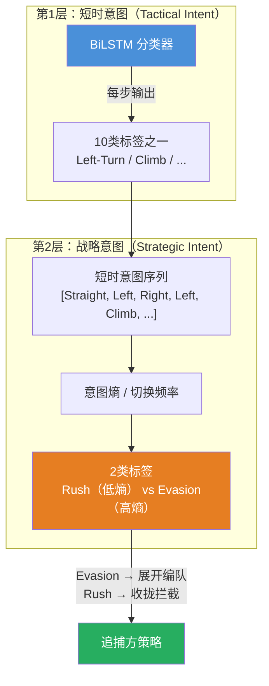

# 回应你的五个评论 — 深入讨论

## 问题1：坐标系的左右判定 — 你的质疑是对的

> "假设目标在守区的左侧，但是他在往右飞，那是怎么判定呢？往守区偏是以位置判断，还是速度判断？"

这个问题一针见血。让我用一个具体例子说明：

```
                     守区(Goal)
                       ●
                      /
                     /  ← e_fwd (target→goal方向)
                    /
         ←←←←← ● 目标 (正在往右飞)
              velocity →→→
```

在**守区方向坐标系**下：
- `e_fwd` = target→goal方向（朝右上）
- 目标往右飞，加速度朝右 → 加速度在 `e_lat` 上的投影可能为正也可能为负，**取决于目标和守区的相对位置**
- 同样是"往右飞"，目标在守区左侧和右侧时，标签可能不一样

**这就是问题所在**：守区方向坐标系下，"Left/Right"的含义会随目标位置变化而翻转，**同一种物理机动行为（右转）在不同位置可能得到不同的标签**。这对机器学习来说是灾难性的——网络需要学习一个不一致的映射。

### 修正方案：回到速度方向坐标系，但加低速保护

我收回之前的建议。正确的做法是：

```python
def build_labeling_frame(target_vel, goal_direction, speed_threshold=0.3):
    """
    构建标注坐标系
    - 高速时：用速度方向（Frenet-Serret），物理含义一致
    - 低速时：用目标→守区方向兜底，同时打Hover标签
    """
    speed = norm(target_vel)
    
    if speed > speed_threshold:
        # 高速：用速度方向作为前向轴
        e_fwd = target_vel / speed           # 速度方向
        e_up  = [0, 0, 1]                    # 世界Z
        e_lat = normalize(cross(e_up, e_fwd)) # 侧向
        # 注意：如果速度接近垂直，需要额外处理
        frame_valid = True
    else:
        # 低速 / 悬停：速度太小，坐标系不可靠
        # 此时直接标为 Hover，不需要分解 a_lat / a_lon
        e_fwd = goal_direction  # 兜底用守区方向
        e_up  = [0, 0, 1]
        e_lat = normalize(cross(e_up, e_fwd))
        frame_valid = False  # 标记：不应该用于 Left/Right 标签
    
    return e_fwd, e_lat, e_up, frame_valid
```

**为什么速度方向坐标系才是对的**：

"左转"的物理含义是"**相对于我当前的运动方向向左偏**"——不管目标在守区的哪一侧，不管目标朝哪个方向飞，"左转"永远是相对于速度方向的左侧。这确保了：
- 同一种物理机动 → 同一个标签（**标签一致性**）
- 网络从轨迹学到的特征（曲率、转向率）与标签完全对应

> [!NOTE]
> **关于 Frenet-Serret 奇异性**：你的场景中，APF力场保证目标几乎始终在运动（至少有守区吸引力），所以悬停只是"很小概率"。这意味着 Frenet-Serret 退化的情况非常罕见，完全可以用低速阈值兜底 + Hover标签来处理。**之前我过度担心了这个问题。**

### 完整的标注逻辑

```python
def auto_label(a_cmd, target_vel, goal_direction, a_max, speed_threshold=0.3):
    speed = norm(target_vel)
    
    # Step 1: 低速判定
    if speed < speed_threshold:
        return "Hover"
    
    # Step 2: 构建速度方向坐标系
    e_fwd = target_vel / speed
    e_up  = [0, 0, 1]
    e_lat = normalize(cross(e_up, e_fwd))
    
    # Step 3: 分解加速度
    # 去除沿速度方向的切向分量，保留法向加速度
    a_tangential = dot(a_cmd, e_fwd) * e_fwd
    a_normal = a_cmd - a_tangential
    
    a_lat = dot(a_normal, e_lat)   # 侧向：正=左转，负=右转
    a_lon = dot(a_normal, e_up)    # 垂直：正=爬升，负=俯冲
    
    # Step 4: 阈值判定
    epsilon = 0.1 * a_max   # 无机动死区
    
    lat_label = "none"
    if a_lat > epsilon:
        lat_label = "left"
    elif a_lat < -epsilon:
        lat_label = "right"
    
    lon_label = "none"
    if a_lon > epsilon:
        lon_label = "climb"
    elif a_lon < -epsilon:
        lon_label = "dive"
    
    # Step 5: 组合标签
    label_map = {
        ("none",  "none"):  "Straight",
        ("left",  "none"):  "Left-Turn",
        ("right", "none"):  "Right-Turn",
        ("none",  "climb"): "Climb",
        ("none",  "dive"):  "Dive",
        ("left",  "climb"): "Left-Climb",
        ("left",  "dive"):  "Left-Dive",
        ("right", "climb"): "Right-Climb",
        ("right", "dive"):  "Right-Dive",
    }
    return label_map[(lat_label, lon_label)]
```

---

## 问题2：论文Focus — 拦截而非守区

> "我的论文更关注的是拦截到无人机，不让他到守区只是最低标准"

理解了。这进一步验证了用**速度方向坐标系**的正确性：

- 守区方向坐标系隐含假设"追捕方的目标是阻止目标到达守区"
- 但你的核心目标是**拦截**——即缩短追捕方与目标的距离直到捕获
- 对于拦截来说，追捕方关心的是"目标接下来往哪个方向运动"，这正是速度方向坐标系下标签的含义

**且这也影响了机动标签的设计优先级**：

| 标签 | 对"守区防御"的重要性 | 对"拦截"的重要性 |
|------|---------------------|-----------------|
| Straight (朝守区直飞) | ⭐⭐⭐⭐⭐ 最危急 | ⭐⭐⭐ 路径可预测，拦截反而容易 |
| Left/Right Turn | ⭐⭐⭐ 偏离守区，风险降低 | ⭐⭐⭐⭐⭐ **路径突变，拦截困难** |
| Climb/Dive | ⭐⭐ | ⭐⭐⭐⭐ 3D规避增加拦截难度 |
| Hover | ⭐ | ⭐⭐ 最好拦截，但需确认不是假动作 |

对于拦截目标，**转弯类和复合机动类才是最需要准确识别的**——因为这些是导致拦截失败的主因。

---

## 问题3：Hover标签 — 确认加入

10类意图空间确认：

```python
INTENT_LABELS = [
    "Straight",      # 0: 高速直线（沿当前速度方向）
    "Left-Turn",     # 1: 左转
    "Right-Turn",    # 2: 右转
    "Climb",         # 3: 爬升
    "Dive",          # 4: 俯冲
    "Left-Climb",    # 5: 左转+爬升
    "Left-Dive",     # 6: 左转+俯冲
    "Right-Climb",   # 7: 右转+爬升
    "Right-Dive",    # 8: 右转+俯冲
    "Hover",         # 9: 悬停/低速（四旋翼特有）
]
```

---

## 问题4：双层意图 — 这是一个非常好的想法

> "可以有两个意图，一个是短时意图，一个是战略意图；短时意图就是上面的分类，战略意图就是他是在做规避机动还是在往守区前进"

这个双层结构非常有学术价值，我来帮你完善它的逻辑：

### 双层意图架构



### 战略意图的判定逻辑

你的直觉完全正确——"短时意图一直在变 → 规避模式"。这可以用**意图熵**来量化：

```python
def compute_strategic_intent(short_term_intent_history, window=30):
    """
    输入：最近 window 步的短时意图序列（每步一个0-9的整数）
    输出：战略意图（Rush / Evasion）+ 不确定性
    """
    # 统计窗口内各意图的出现频率
    intent_counts = histogram(short_term_intent_history, bins=10)
    intent_probs = intent_counts / window
    
    # 计算意图熵
    entropy = -sum(p * log(p + 1e-8) for p in intent_probs if p > 0)
    max_entropy = log(10)  # 均匀分布时的最大熵
    normalized_entropy = entropy / max_entropy  # [0, 1]
    
    # 计算意图切换频率
    switches = sum(1 for i in range(1, window) 
                   if short_term_intent_history[i] != short_term_intent_history[i-1])
    switch_rate = switches / (window - 1)  # [0, 1]
    
    # 综合判定
    evasion_score = 0.6 * normalized_entropy + 0.4 * switch_rate
    
    strategic_intent = "Evasion" if evasion_score > 0.3 else "Rush"
    uncertainty = evasion_score  # 可直接作为预测不确定性的代理
    
    return strategic_intent, uncertainty
```

### 战略意图如何连接到追捕方策略

你说的"规避时包围范围要大一点"是完全合理的。具体化：

```
Strategic Intent = Rush (低不确定性):
  → 目标轨迹可预测
  → 三架追捕方收拢编队，集中到预测的拦截点
  → 编队展开半径 ∝ (1 - evasion_score) × base_spread
  
Strategic Intent = Evasion (高不确定性):
  → 目标轨迹不可预测，可能随时变向
  → 三架追捕方展开编队，覆盖更大的空间角
  → 编队展开半径 ∝ (1 + evasion_score) × base_spread
  → 同时，每架无人机应该更多依赖短时意图做即时反应
```

> [!IMPORTANT]
> **论文故事线**：双层意图是一个清晰的贡献点。你可以这样讲故事：
> 1. "现有方法只预测单一时间尺度的意图，无法区分'即时转弯动作'和'持续性规避策略'"
> 2. "我们提出双层意图架构：短时意图捕捉即时机动类型，战略意图反映行为模式的稳定性"
> 3. "战略意图的不确定性直接指导追捕编队的展开策略——高不确定性时展开、低不确定性时收拢"

### 战略意图是用规则推导还是用网络学习？

两种方案各有优劣：

| | 规则推导（上面的熵+切换率） | 网络学习（额外一个分类头） |
|---|---|---|
| **优点** | 可解释、无需额外训练数据、不会引入新的学习难度 | 可能学到更复杂的模式（如"先直飞再突然变向"的前兆） |
| **缺点** | 假设"意图变化=规避"，可能过于简化 | 需要额外标注战略意图标签，训练更复杂 |
| **推荐** | ✅ 先用这个作为baseline | 作为改进版本，可选 |

**建议先用规则推导**。理由：
1. 战略意图只有2类（Rush/Evasion），规则就够了
2. 可解释性对论文很重要——reviewers能直观理解你的方法
3. 减少一个需要训练的模块，降低系统复杂度

---

## 问题5：数据集规模 — 留到后面

同意，数据集规模取决于你最终的仿真配置。但有几个经验值可以参考：

- 论文中意图识别用了 ~50,000 个滑窗样本（70/15/15 split）
- 论文中轨迹预测用了 50,000 条轨迹（80/20 split）
- 你的四旋翼场景机动时间更短，每条轨迹产生的滑窗样本会更少
- **粗估：至少需要收集 5,000-10,000 条完整轨迹，才能在10类上获得足够的样本量**

---

## 总结：目前我们达成的共识与下一步

### 已确定的设计决策

| 项目 | 决策 |
|------|------|
| 坐标系 | **速度方向坐标系**（Frenet-Serret），低速时回退到Hover标签 |
| 意图空间 | **10类**：9种机动 + Hover |
| 双层意图 | **短时意图**（10类分类）+ **战略意图**（Rush/Evasion，规则推导） |
| 标注方法 | a_cmd 切平面分解 → 阈值决策树 → 滑窗投票 |
| 标注来源 | 训练标签用 a_cmd，推理用速度差分 |

## 整体架构

将“离散分类的战术意图”、“连续标量的战略分数”和“多模态的GMM轨迹”结合，在深度学习中有一个非常经典的架构叫做 **MDN（Mixture Density Network，混合密度网络）**。

引入“意图调制（Intent Modulation）”机制。

下面我为你设计一套“双层意图条件化 GMM 解码器”的融合架构方案，我们一步一步来讨论：

### 第一步：特征的对齐与拼接（基础融合）

首先，在进入预测网络的解码器之前，你需要把所有信息压缩成一个高维的**上下文向量（Context Vector） $Z$**。

1. **运动学特征提取**：用一个轻量级的 GRU 将目标过去 $N$ 步的 $(x, y, z, v_x, v_y, v_z)$ 编码成隐藏层特征 $h_{traj}$。
2. **战术意图接入**：BiLSTM 输出的 10 维战术概率向量 $P_{tactical}$（比如 `[0.1, 0.8, 0.0, ...]` 代表大概率左转）。
3. **战略意图接入**：你写的那段代码算出来的规避得分 $S_{evasion}$（一个 0 到 1 之间的标量）。

我们在进入解码器前，将它们拼接：

$$Z = \text{MLP}([h_{traj}, P_{tactical}, S_{evasion}])$$

*这就告诉了预测网络：“目标过去是怎么飞的”、“它下一秒想干嘛”、“它现在有多慌”。*

### 第二步：GMM 的多头输出设计（分化多模态）

拿到融合特征 $Z$ 后，你的网络（比如一个多层感知机 MLP 或 GRU 解码器）不再输出一个 $[x, y, z]$，而是**分裂成三个并行的线性输出头（Heads）**，用来生成 GMM（假设我们设定 $K=3$ 个高斯分支）：

1. **权重头（Weight Head $\pi$）**：
   - 负责输出这 3 条轨迹各自的发生概率。
   - 网络输出 3 维向量，过一层 `Softmax`，得到 $[\pi_1, \pi_2, \pi_3]$，且 $\sum \pi_i = 1$。
2. **均值头（Mean Head $\mu$）**：
   - 负责输出 3 条具体的预测轨迹中心线。
   - 网络输出 $3 \times (T \times 3)$ 维的数据（假设预测未来 $T$ 步，每步有 $x,y,z$）。
3. **方差头（Variance Head $\sigma$）**：
   - 负责输出每条轨迹的宽窄（不确定性管径）。
   - 网络输出与均值同维度的数据，但必须过一层 `exp()` 激活函数，因为方差必须是正数。

### 第三步：你的核心创新点 —— 战略分数的“物理调制”

如果仅仅做到第二步，那这只是一个普通的 MDN 网络。**你这篇论文的亮点在于：如何用你算出来的 $S_{evasion}$ 去强行约束 GMM，让网络不再“瞎猜”，而是符合物理常理。**

你可以设计以下两个“调制公式”直接写进神经网络的前向传播（Forward Pass）代码里：

#### 调制机制 1：基于战略得分的“温度缩放（Temperature Scaling）”

在计算 GMM 权重 $\pi$ 时，普通的 Softmax 是 $\pi_i = \frac{\exp(logits_i)}{\sum \exp(logits_j)}$。

我们可以把战略规避得分 $S_{evasion}$ 作为**温度系数 $\tau$** 融合进去：

$$\tau = 1.0 + \alpha \cdot S_{evasion}$$

$$\pi_i = \frac{\exp(logits_i / \tau)}{\sum \exp(logits_j / \tau)}$$

- **物理意义**：当目标处于 Rush（$S_{evasion} \to 0$）时，$\tau \to 1$，网络算出的权重分布会非常尖锐（比如 `[0.98, 0.01, 0.01]`），GMM 退化为单模态，告诉追捕机“它就是要往这冲”。当目标处于 Evasion（$S_{evasion} \to 1$）时，$\tau$ 变大，Softmax 会被“软化”（平滑），强制使得三条轨迹的权重趋于平均（比如 `[0.35, 0.33, 0.32]`），强制激发多模态分化。

#### 调制机制 2：方差膨胀（Variance Inflation）

网络自己输出的方差 $\sigma_{net}$ 往往不够鲁棒，我们可以用战略分数直接去放大它：

$$\sigma_{final} = \sigma_{net} \cdot (1 + \beta \cdot S_{evasion})$$

- **物理意义**：如果目标在疯狂乱窜（$S_{evasion}$ 高），不仅权重会平分给 3 条路线，而且每条路线的预测管径（方差）都会被直接撑大。这就直接给外围的 3 架追捕机下达了物理指令：**“目标极其不稳定，拉大包围圈！”**。

### 讨论：训练这个模型的一个大坑

结合 GMM 之后，你绝对不能再用传统的均方误差（MSE Loss）去训练你的预测网络了。因为如果目标实际往左跑，你的 GMM 算出了左、中、右三条线，MSE 会试图把你的中心线扯到偏左的位置，最后网络会崩溃。

你必须使用 **NLL Loss（负对数似然损失）** 配合 **WTA（Winner-Takes-All，赢家通吃）** 机制：

在训练时，每次只挑那条离目标真实轨迹**最近**的高斯分支（Winner）去计算位移 Loss 并反向传播，剩下两条分支不计算位移 Loss，只更新 $\pi$ 的概率。

**我们先对齐一下思路**：

你觉得这套 **[拼接融合 $\rightarrow$ MDN多头解码 $\rightarrow$ 战略分数物理调制]** 的架构，符合你对“直接结合”的预期吗？尤其是“温度缩放”和“方差膨胀”这两个可以直接写进论文公式的机理，你觉得在你的 APF 数据集下能跑出效果吗？
