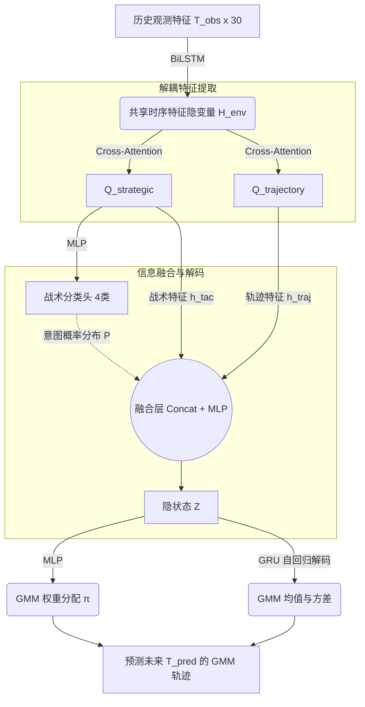

# 意图驱动的 GMM 轨迹预测网络（精简版）架构说明

本文档详细说明了在移除了冗余的 9 类机动分类头之后，专门为您后续的**强化学习追捕控制器**服务的**单层意图轨迹预测网络**的结构与输入输出接口。

---

## 一、 输入数据 (Inputs)

网络在推理（部署到控制器）时，接收的是固定时间窗口的历史观测特征。

### 1. 数据维度
- **输入 Tensor 形状**: `(BatchSize, T_obs, 30)`
- **时间步**: `T_obs = 10` 帧（对应历史 0.5s，采样频率 20Hz / dt=0.05s）

### 2. 30维相对运动学特征解析
对于当前时刻 `t` 的每一帧，30维向量由以下部分拼接而成（采用全局坐标系的绝对差值，具有旋转不变性的部分）：
1. `[0:9]` **目标相对于追捕者的位置差**: `target_pos - pursuer_pos` (3个追捕者 × 3D)
2. `[9:18]` **目标相对于追捕者的速度差**: `target_vel - pursuer_vel` (3个追捕者 × 3D)
3. `[18:21]` **目标相对于防守区域的距离**: `target_pos - goal_center` (1个目标 × 3D)
4. `[21:30]` **追捕者相对于防守区域的距离**: `pursuer_pos - goal_center` (3个追捕者 × 3D)

---

## 二、 网络内部结构 (Architecture)

精简后的网络采用 **Encoder-Decoder** 架构，中间通过 **Cross-Attention** 提取特定任务的特征。

### 1. 共享时序编码器 (BiLSTM Encoder)
- **作用**: 将 10 帧的 30D 序列特征压缩为包含时间演化信息的隐状态 `H_env`。
- **输出**: `(BatchSize, T_obs, d_model)`

### 2. 交叉注意力机制 (Task-specific Cross-Attention)
- **作用**: 避免分类任务和轨迹预测任务“抢夺”相同的特征。网络定义了两个可学习的查询向量（Query）：
  - `Q_strategic`: 专门去 `H_env` 里搜寻“当前战术意图（跑路还是冲锋）”的线索。
  - `Q_trajectory`: 专门去 `H_env` 里搜寻“下一秒往哪里飞”的物理惯性线索。
- **输出**: `h_strategic` 和 `h_trajectory`，维度均为 `(BatchSize, d_model)`

### 3. 战术分类头 (Strategic Head)
- **作用**: 输出 4 类高层战术意图的概率分布。
- **类别**:
  1. `Far_Rush` (距离较远，全速冲刺)
  2. `Close_Evade` (距离极近，启动规避机动)
  3. `Goal_Priority` (不顾一切冲向守区)
  4. `Goal_Sprint` (最后阶段的直线冲刺)

### 4. 融合与 GRU 解码器 (Fusion & GRU Decoder)
- **融合**: 将分类头输出的意图概率 `P(strategic)` 与隐特征拼接，使得解码器能够明确“知晓”目标当前的战术。
- **GRU解码**: 区别于普通 MLP 一次性吐出所有轨迹点，GRU 会“一步一步”地生成未来的轨迹参数，这保证了生成轨迹的物理平滑性。

---

## 三、 输出数据 (Outputs)

网络最终吐出的不是一条确定性的线，而是一个 **高斯混合模型 (GMM)** 的参数，用来描述未来目标位置的概率分布（捕捉多模态不确定性）。

### 1. 网络直接输出的 Tensor
在推理代码中，`model(obs)` 返回一个字典，包含以下关键字段：
- **`strategic_probs`**: `(BatchSize, 4)`，当前 4 种战术意图的预测概率。
- **`gmm_weights` (π)**: `(BatchSize, 3)`，3 个 GMM 轨迹分量的置信度权重（和为1）。
- **`gmm_means` (μ)**: `(BatchSize, 3, T_pred, 3)`，3 条可能的未来轨迹的 XYZ 坐标差值（相对于当前时刻 `t`）。
- **`gmm_vars` (σ²)**: `(BatchSize, 3, T_pred, 3)`，上述轨迹在各个点上的不确定性（方差）。

> *注：`T_pred` 默认为 10（对应未来 0.5s）。*

### 2. 为控制器服务的简化输出（Mixed Mean）
虽然网络输出了 3 条带概率的轨迹，但强化学习控制器通常只需要一个**确定性**的预测。为此，我们在代码中提供了一个融合结果：
- **`mixed_mu`**: `(BatchSize, T_pred, 3)`
- **计算逻辑**: `mixed_mu = sum(gmm_weights[k] * gmm_means[k])`
- **使用建议**: 您的 RL 追捕控制器可以**直接提取 `mixed_mu`** 作为目标在未来 0.5s 的预测绝对坐标序列。它是一个平滑的综合预测结果。
