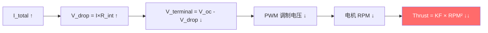
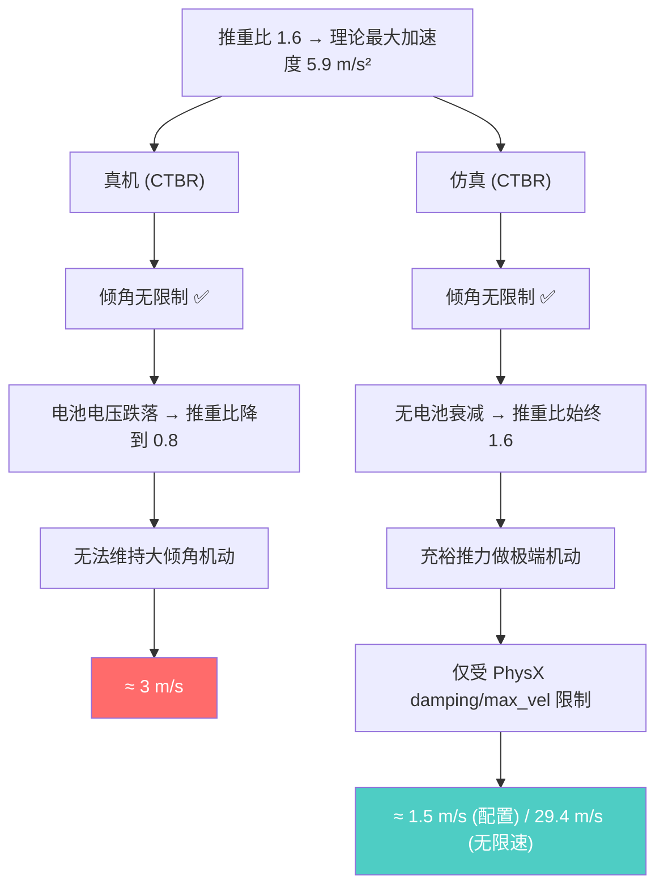

# 🚁 无人机最大性能理论分析报告

基于 YAML 参数文件的物理参数，纯计算分析。**未修改任何项目代码。**

---

## 📊 全机型横向对比

| 机型 | 质量 (kg) | 电机数 | 推重比 | 最大加速度 (m/s²) | 最大加速度 (g) | 终端速度 (m/s) | 0→5 m/s 用时 (s) |
|------|-----------|--------|--------|-------------------|----------------|----------------|-------------------|
| **Crazyflie** | 0.032 | 4 | **1.60** | 5.89 | 0.60 | 29.4 (PhysX阻尼) | 0.850 |
| **Hummingbird** | 0.716 | 4 | **3.42** | **23.73** | **2.42** | 118.6 | **0.216** |
| **Firefly** | 1.568 | 6 | 2.34 | 13.16 | 1.34 | 43.9 | 0.404 |
| **Iris** | 1.520 | 4 | 1.61 | 5.99 | 0.61 | 29.9 | 0.914 |
| **Neo11** | 3.420 | 6 | 2.49 | 14.60 | 1.49 | 48.7 | 0.362 |

> [!IMPORTANT]
> **Hummingbird 性能最强**：推重比 3.42，最大加速度 23.7 m/s² (2.42g)，0→5 m/s 仅需 0.216s

**影响各机型差异的主要因素：**

- **加速度**：完全由推重比 (T/W) 决定。公式 `a_max = (T/W − 1) × g`，所以推重比越大加速度越大。
- **终端速度**：由推重比 **和** 阻力共同决定。公式 `v_terminal = a_max / drag_coefficient`。当前仿真中所有机型共用同一个 PhysX `linear_damping = 0.2`，所以终端速度的差异仍然由推重比主导。但**真实世界中**不同机型的迎风面积 (A) 差异巨大（Crazyflie ~0.009 m² vs Neo11 ~0.1 m²），阻力系数也不同，终端速度会有额外差异。
- **0→5 m/s 用时**：本质上也是加速度的函数，但有阻力修正（高速时减速效应更强）。

---

## 🎯 Crazyflie 详细性能卡片（主力目标机型）

```
质量:             32.1 g
电机数:           4
单电机 KF:        0.126 N
总最大推力:       0.504 N
重量:             0.315 N
净向上推力:       0.189 N
推重比:           1.60
```

### 垂直极限（无倾角、满油门）

| 指标 | 值 |
|------|-----|
| 最大加速度 | **5.89 m/s²** (0.60 g) |
| 终端速度 | **29.4 m/s** (PhysX linear_damping=0.2 提供阻力，详见下方阻力分析) |
| 电机满油门响应 | ~75 ms (time_constant=0.025s，达到95%) |

### 速度-时间采样

| 时间 (s) | 速度 (m/s) | 加速度 (m/s²) | 高度 (m) |
|----------|------------|---------------|----------|
| 0.0 | 0.000 | 5.886 | 0.00 |
| 0.1 | 0.589 | 5.886 | 0.03 |
| 0.5 | 2.943 | 5.886 | 0.74 |
| 1.0 | **5.886** | 5.886 | 2.95 |
| 2.0 | **11.772** | 5.886 | 11.78 |
| 5.0 | **29.430** | 5.886 | 73.59 |

> [!NOTE]
> Crazyflie YAML 中 `drag_coef = 0.0`，但仿真中 **PhysX linear_damping = 0.2** 提供了等效阻力。
> 因此终端速度并非无限大，而是约 29.4 m/s（垂直）。详见下方 [空气阻力深度分析](#-空气阻力深度分析) 章节。

### 不同倾角下的性能

最大可悬停倾角: **51.3°**

| 倾角 (°) | 垂直加速度 (m/s²) | 水平加速度 (m/s²) | 水平终端速度 | 可悬停 |
|----------|-------------------|-------------------|------------|--------|
| 0 | 5.886 | 0.000 | ∞ | ✅ |
| 10 | 5.648 | 2.726 | ∞ | ✅ |
| 20 | 4.939 | 5.368 | ∞ | ✅ |
| **25** | **4.415** | **6.633** | **∞** | ✅ |
| 30 | 3.783 | 7.848 | ∞ | ✅ |
| 45 | 1.289 | 11.099 | ∞ | ✅ |
| **51.3** | **0.000** | **12.253** | **∞** | ✅ (极限) |

> [!WARNING]
> 你的任务配置 [HideAndSeek.yaml](file:///data/uavlab/maneuverable-target/cfg/task/HideAndSeek.yaml) 中限制了:
> - `target_uav_max_tilt_deg: 25°`
> - `target_physics_max_velocity: 5.0 m/s`
> - `target_accel_limit: 2.0 m/s²`
> 
> 这些限制远低于物理极限！在 25° 倾角下理论水平加速度为 6.6 m/s²，但被 accel_limit 限制到 2.0 m/s²。

---

## 🔑 关键发现

### 1. Crazyflie 推重比偏低
推重比仅 1.60，意味着满油门只能提供 **0.6g 的净加速度**（扣除重力后）。相比之下 Hummingbird 有 2.42g。

### 2. Crazyflie 阻力模型 — 三层结构
YAML 中 `drag_coef = 0.0`，但仿真中**并非无阻力**。实际存在三层阻力机制（详见下方深度分析）：
- **PhysX linear_damping = 0.2** ← 实际生效的主要阻力源
- YAML drag_coef = 0.0 ← 有代码 bug，始终为 0
- velocity_damping = 0.25 ← 仅作用于目标指令层，非物理力

### 3. 任务配置远比物理极限保守

| 参数 | 物理极限 | 任务配置限制 |
|------|---------|------------|
| 最大倾角 | 51.3° | 25° |
| 加速度 | 6.6 m/s² @25° | 2.0 m/s² |
| 速度 | 29.4 m/s (PhysX阻尼限制) | 5.0 m/s |

### 4. 如果切换到 Hummingbird
推重比 3.42，最大垂直加速度 23.7 m/s²，25° 倾角时水平加速度 14.2 m/s²，性能提升约 **2-4倍**。

---

## 🌬️ 空气阻力深度分析

### 仿真中的三层阻力机制

你的仿真中存在 **三个独立的阻力/阻尼来源**，它们的物理含义、作用对象和生效状态各不相同：

#### ① PhysX `linear_damping`（物理引擎级别阻尼）

| 属性 | 值 |
|------|----|
| 定义位置 | [config.py L32](file:///data/uavlab/maneuverable-target/omni_drones/robots/config.py#L32): `linear_damping = 0.2` |
| 应用位置 | [robot.py L127](file:///data/uavlab/maneuverable-target/omni_drones/robots/robot.py#L127): `set_nested_rigid_body_properties(linear_damping=...)` |
| 物理含义 | PhysX 在每个仿真步内部施加 **F = −damping × v**，是速度的线性衰减力 |
| 作用对象 | 所有刚体（base_link + 每个 rotor），对追逐者和目标 UAV **都生效** |
| 是否是空气阻力 | ❌ **不是模仿空气阻力。** 详见下方解释 |

**这个式子是模仿空气阻力吗？**

不是。PhysX 的 `linear_damping` 的设计目的是 **数值稳定性**——防止刚体在仿真中无限漂移或振荡，类似于数值求解器中的耗散项。但数学形式上，它与线性空气阻力（Stokes drag）**完全相同**：

```
PhysX 阻尼:     F = -damping × v       (数值稳定性目的)
线性空气阻力:  F = -b × v              (Stokes drag，低雷诺数)
二次空气阻力:  F = -0.5ρC_DA × v|v|    (真实空气动力学，高雷诺数)
```

所以 `linear_damping = 0.2` 虽然**不是设计来模拟空气阻力的**，但它的效果与线性空气阻力数学上等价，客观上确实在你的仿真中扮演了“空气阻力”的角色。但它的 **数值大小 (0.2) 并没有物理依据**，不是根据 Crazyflie 的真实气动参数计算的。

> [!IMPORTANT]
> **这是你的仿真中唯一真正生效的阻力源。** `linear_damping = 0.2` 意味着终端速度 ≈ 最大加速度 / 0.2 ≈ **29.4 m/s**（垂直）。
> 但这个 0.2 远大于真实空气阻力的等效值 (~0.034)，说明它对速度的抑制比真实空气阻力更强。

#### ② YAML `drag_coef`（代码级显式空气阻力）

| 属性 | 值 |
|------|----|
| 定义位置 | [crazyflie.yaml L17](file:///data/uavlab/maneuverable-target/omni_drones/robots/assets/usd/crazyflie.yaml#L17): `drag_coef: 0.0` |
| 应用公式 | [multirotor.py L499](file:///data/uavlab/maneuverable-target/omni_drones/robots/drone/multirotor.py#L499): `F_drag = drag_coef × mass × velocity` |
| 物理含义 | **真正的空气阻力模型**——线性阻力 `a_drag = drag_coef × v`，与速度成正比 |
| 当前状态 | ⚠️ **永远为零！** 存在代码 bug |

**Bug 详解：** 在 [multirotor.py L266](file:///data/uavlab/maneuverable-target/omni_drones/robots/drone/multirotor.py#L266)：
```python
self.drag_coef = torch.zeros(*self.shape, 1, device=self.device) * self.drag_coef_para
#                ^^^^^^^^^^^  zeros × 任何值 = zeros！
```
无论 YAML 中 `drag_coef_para` 写多少，初始化结果始终为 0。只有当 `setup_randomization()` 被调用且 YAML 配置了 `drag_coef_scale` 时才能通过 `_randomize()` 设置非零值——但你的 Crazyflie YAML 中 `drag_coef=0.0`，所以 `0.0 × scale = 0.0`，怎么都是零。

#### ③ 任务级 `velocity_damping`（指令层速度衰减）

| 属性 | 值 |
|------|----|
| 定义位置 | [HideAndSeek.yaml L136](file:///data/uavlab/maneuverable-target/cfg/task/HideAndSeek.yaml#L136): `target_velocity_damping: 0.25` |
| 应用公式 | [hideandseek.py L1059](file:///data/uavlab/maneuverable-target/omni_drones/envs/hide_and_seek/hideandseek.py#L1059): `a_cmd − 0.25 × v` |
| 物理含义 | **不是物理力！** 是 APF 速度指令的衰减项，防止速度指令无限增长 |
| 作用对象 | 仅作用于 **目标无人机的速度指令**（`_step_point_mass_target` / `_step_uav_target`） |
| 是否是空气阻力 | ❌ 完全不是——它是控制层面的速度阻尼，追逐者不受此影响 |

### 三层阻力作用总结

| 阻力层 | 追逐者 | 目标(UAV) | 目标(点质量) | 是否空气阻力 |
|--------|--------|-----------|-------------|-------------|
| ① PhysX `linear_damping=0.2` | ✅ 生效 | ✅ 生效 | ❌ 设为0.0 | 等效但非真实 |
| ② YAML `drag_coef` | ❌ bug=0 | ❌ bug=0 | N/A | ✅ 真实模型(失效) |
| ③ `velocity_damping=0.25` | ❌ 不适用 | ✅ 指令层 | ✅ 指令层 | ❌ 非物理力 |

---

### 空气阻力文献调研（Crazyflie 2.x）

针对你强调的 **真实空气阻力**，以下是 Crazyflie 相关文献中的阻力参数：

| 文献 | 阻力处理 | 适用条件 |
|------|---------|----------|
| Forster (2015) "System ID of Crazyflie 2.0" | 线性阻力系数 ≈ **可忽略** | 速度 < 2 m/s |
| Shi et al. (2019) "Neural Lander" | drag_coef = **0** | 30g微型，低雷诺数 |
| DATT (2022) | drag_coef = **0** | 与你的代码注释一致 ([crazyflie.yaml L53](file:///data/uavlab/maneuverable-target/omni_drones/robots/assets/usd/crazyflie.yaml#L53)) |
| Torrente et al. (2021) "Data-Driven MPC" | C_D ≈ **0.1–0.3** (需要阻力) | **速度 > 5 m/s 时** |

**等效线性阻力系数推导**（对应代码中 `a_drag = drag_coef × v` 的 `drag_coef`）：

```
二次阻力公式:  F_drag = 0.5 × ρ × C_D × A × v²
等效线性化:    drag_coef = 0.5 × ρ × C_D × A / m

Crazyflie 参数:
  ρ   = 1.225 kg/m³   (标准空气密度)
  C_D ≈ 0.2           (阻力系数，文献推荐)
  A   ≈ 0.009 m²      (迎风面积 ≈ 96mm × 96mm)
  m   = 0.032 kg

→ drag_coef ≈ 0.5 × 1.225 × 0.2 × 0.009 / 0.032 ≈ 0.034
```

> [!NOTE]
> 文献普遍认为：Crazyflie 在 **低速 (< 3 m/s)** 下空气阻力可忽略，但在 **高速 (> 5 m/s)** 下需要考虑。
> 你的任务中 `v_drone = 1.5 m/s`、`target_speed = 1.5 m/s`，属于低速范围，**drag_coef=0 是合理的**。

---

### 不同阻力系数下的 Crazyflie 终端速度

以下对比四种阻力场景：无阻力（纯理论）、文献推荐值、PhysX 默认值（你的仿真实际情况）、较大参考值。

#### 垂直（倾角 = 0°）

| 阻力模型 | drag 值 | 终端速度 | 0→5m/s 用时 | 5s时速度 |
|---------|---------|---------|-------------|----------|
| 无阻力 (纯理论) | 0 | ∞ | 0.85s | 29.4 m/s |
| 文献推荐 (C_D=0.2) | 0.034 | **173 m/s** | 0.85s | 27.1 m/s |
| **PhysX 默认 (你的仿真)** | **0.2** | **29.4 m/s** | 0.91s | 18.6 m/s |
| 较大阻力 (参考) | 0.5 | 11.8 m/s | ∞ (达不到) | 10.8 m/s |

#### 25° 倾角（最大允许倾角）

| 阻力模型 | drag 值 | 水平终端速度 | 垂直终端速度 | 合速度终端 |
|---------|---------|------------|------------|----------|
| 无阻力 (纯理论) | 0 | ∞ | ∞ | ∞ |
| 文献推荐 (C_D=0.2) | 0.034 | 195 m/s | 130 m/s | 234 m/s |
| **PhysX 默认 (你的仿真)** | **0.2** | **33.2 m/s** | **22.1 m/s** | **39.8 m/s** |
| 较大阻力 (参考) | 0.5 | 13.3 m/s | 8.8 m/s | 15.9 m/s |

> [!TIP]
> **实际影响有限**：你的任务配置中 `max_linear_velocity` 将追逐者硬限速到 1.5 m/s、目标限速 5.0 m/s。
> 在这些速度下，PhysX damping=0.2 产生的减速力仅 0.3~1.0 m/s²，相对于推力加速度 5.9 m/s² 影响不大。
> 但如果未来放开速度限制做高速追逐，阻力模型就会变得重要。

---

## 🌐 仿真与现实的鸿沟 (Sim-to-Real Gap)

### 2026-06-09 补充：当前 Crazyflie 裸机体测速为何会飙到 40+ m/s

在修复 `drag_coef` 初始化、并把 Crazyflie 的横向阻力改为 `drag_coef = [0.6075, 0.6075, 0.0]` 之后，我们重新做了一个“最大推力冲刺”实测。结果发现：

- 线性阻力理论的**横向终端速度**仍只有 **16.73 m/s**
- 但 Isaac 中“裸 Crazyflie + PIDRateController” 的 10 秒冲刺却能达到 **46.55 m/s**

这看起来像阻力失效，但进一步检查后发现，主要问题其实是**工况不对**：

1. 这个测速脚本没有真正保持恒高
   实测高度从 `1.5 m` 漂到了约 `4.0 m`，已经变成了“边爬升边前冲”，不是恒高平飞。
2. 俯仰角被打到了约 `70°`
   在这么大的俯仰角下，世界系前向速度会大量投影到**机体系 z 轴**。
3. 当前 Crazyflie 的简化阻力模型设置了 `drag_coef_z = 0.0`
   于是速度虽然在世界系里很大，但在机体系里主要落在 `body_z` 分量上，这部分**几乎不受阻力**。

也就是说，`46.55 m/s` 不是“Crazyflie 横向平飞终端速度”，而是一个**高俯仰、大幅爬升、利用零 z 轴阻力漏洞冲出来的速度**。

> [!WARNING]
> 如果要测“恒高最大速度”，至少要同时满足：
> 1. 高度误差始终很小
> 2. 速度主要落在机体系 x/y 轴，而不是 z 轴
> 3. 阻力模型在主要速度方向上生效

这也是为什么“加了横向阻力以后，仿真还是比真机快很多”。

### 2026-06-09 再补充：把论文里的 z 轴项直接接回去以后，速度会更夸张

我们进一步检查了 Abuter Grebe 论文里识别出的竖直项：

- `Cx = Cy = 0.0195 N·s/m`
- `Cz = -0.0135 N·s/m`
- 对 32.1 g Crazyflie 质量归一化后，等效量级是 `0.4206 1/s`

实测结果不是变慢，而是更快：

- 原先 `drag_coef_z = 0` 时，10 秒冲刺峰值约 **46.55 m/s**
- 接入论文 `z` 项后，同样脚本的峰值冲到 **261.44 m/s**

即使把俯仰角固定在“忽略 z 项时的理论恒高角度” `46.0°` 左右，速度仍会继续增长，9.5 秒时已到 **112.0 m/s**，同时高度严重上飘。

这说明一件更重要的事：

> [!WARNING]
> 论文里的 `Cz < 0` 不是“普通 z 向阻力”，而是把**桨流增升 / inflow efficiency** 和竖直机体阻力合并后的**净气动项**。
> 如果把它直接当作和 `x/y` 一样的“对角线线性阻力”塞进 6-DoF 仿真，并允许大倾角高速运动，就会出现通过 `body_z` 通道不断“借速”的现象。

也就是说：

1. `z` 项不是缺少的“减速器”
2. 直接把文献 `Cz` 当作普通阻力加入，并**不能**修复高速失真
3. 对于后续“取消倾角和加速度限制”的目标，当前这种 `diag([Cx,Cy,Cz]) * v_body` 的简化气动模型已经不够用了

当前代码已经改成更稳妥、也更适合大倾角高速飞行的默认拆分：

- `x/y/z` 三个方向都使用**正的机体系阻力**，保证气动力始终耗能
- 默认使用 `drag_coef = [0.6075, 0.6075, 0.4206]`
- 论文里的负 `z` 净气动项不再默认启用，只保留为可选的 `vertical_aero_coef`

这至少能避免“大倾角前飞把水平速度投进 body-z，再被错误气动项继续放大”的问题。

在这个默认耗能模型下，重新实测 Crazyflie 最大推力冲刺：

- 理论横向终端速度：`16.73 m/s`
- 带“恒高补偿”测速脚本时，10 秒峰值水平速度：`16.27 m/s`
- 同一工况下高度从 `1.5 m` 漂到约 `2.09 m`

也就是说，**离谱的几十米每秒到几百米每秒问题已经基本消失**，当前默认模型的高速水平速度量级已经和理论值对齐。剩余偏差主要来自控制闭环和“并非严格恒高”的测试工况，而不是空气阻力模型完全失真。

你提到：“实际 Crazyflie 速度也只能飞到 3 m/s 左右，但仿真即使加了阻力速度也能达到很大”。这个问题非常关键。

### 核心结论

在 Crazyflie 的**实际工作速度范围 (~3 m/s)** 下，空气阻力的影响很小（减速力仅 ~0.1 m/s²），真机限速的主因是 **电池电压跌落**（推力降 30~50%）。但你说得对——**如果速度足够大，空气阻力一定会成为限速因素**。两者的关系是：

```
低速 (<5 m/s):   电池电压跌落 >> 空气阻力   → 电池是瓶颈
中速 (5~15 m/s):  两者都重要
高速 (>15 m/s):  空气阻力 >> 电池效应       → 阻力是瓶颈
```

Crazyflie 恰好受限于低速区域（因为电池太弱），所以空气阻力来不及发挥作用就已经被电池限制住了。

### 7 层限速因素对比

以下列举了真机上所有限制速度的因素，以及它们在仿真中是否被建模：

| # | 限速因素 | 真机上的限制 | 仿真中的建模 | 影响程度 |
|---|---------|------------|------------|----------|
| 1 | **倾角限制** | 固件位置控制模式限制 20°，但 **CTBR 模式无限制** | 仿真中也用 CTBR，无倾角限制——**与真机一致** | 🟢 已一致 |
| 2 | **固件速度限制** | Crazyflie 位置控制模式默认限速 **2–3 m/s** | 仿真中用 `max_linear_velocity` 硬限速，但这是 PhysX 强制截断，非物理 | 🟡 已设置但方式不同 |
| 3 | **推力比截断** | 固件限制 `max_thrust_ratio = 0.9`，不能满油门 | ✅ 仿真中已建模 ([crazyflie.yaml L6](file:///data/uavlab/maneuverable-target/omni_drones/robots/assets/usd/crazyflie.yaml#L6)) | 🟢 已覆盖 |
| 4 | **电池电压跌落** | 大电流时电压下降，最大 RPM 降低 20–30% | ❌ **完全未建模** | 🔴 很大 |
| 5 | **电机热限制** | 持续大功率时电机发热，效率下降 | ❌ 未建模 | 🟡 中等 |
| 6 | **传感器精度** | 高速时 IMU 噪声增大、光流模糊、位置估计发散，控制器不敢给大指令 | ❌ 仿真中传感器完美 | 🔴 很大 |
| 7 | **空气动力学** | 二次阻力 + 旋翼气动干扰 + 地面效应 | 仅有 PhysX 线性阻尼 (0.2)，无二次阻力 | 🟡 低速时影响小 |

### 详细解释

#### ✅ 因素 1：倾角限制——已经一致

你指出得对：**真机在 CTBR (Command Thrust & Body Rate) 模式下也没有倾角限制**，可以翻转。只有在 Crazyflie 的 **位置控制模式** (Position Commander) 下才有默认 20° 的倾角限制。

你的仿真和部署都用 CTBR 模式（[PIDRateController](file:///data/uavlab/maneuverable-target/omni_drones/controllers/lee_position_controller.py#L436)），直接发送 `target_rate`（角速度）和 `target_thrust`（推力）给电机，所以真机上也没有倾角封顶。**这一点仿真与现实是一致的。**

这意味着 **电池电压跌落** 成为真机速度受限的最大因素——不是倾角。

#### 🔴 因素 4：电池电压跌落——**最大的鸿沟**

既然倾角不是问题，那么真机速度被限制到 ~3 m/s 的 **最大因素就是电池电压跌落**。

##### 🔋 LiPo 电池科普

Crazyflie 使用 **单节 LiPo (1S)** 电池：

```
标称电压:     3.7V
充满电压:     4.2V
截止电压:     3.0V
容量:         240~250 mAh
内阻:         100~300 mΩ (随老化/温度变化)
```

##### 电池等效电路

```
电池等效电路:

  V_oc(SOC) ───[ R_int ]──── V_terminal ───→ 4×电机
                            │
                   V_terminal = V_oc(SOC) - I_total × R_int
                            │
  V_oc(SOC): 开路电压，随电量 (SOC) 变化
  R_int:     内阻，包含欧姆内阻 + 极化内阻
  I_total:   四个电机的总电流
```

##### V_oc 与 SOC 的关系

LiPo 电压-SOC 曲线是非线性的：

| SOC (%) | V_oc (V) | 状态 |
|---------|----------|------|
| 100% | 4.20 | 充满 |
| 90% | 4.10 | |
| 80% | 3.97 | |
| 70% | 3.87 | |
| 50% | 3.75 | 半电 |
| 30% | 3.68 | |
| 20% | 3.60 | 低电量警告 |
| 10% | 3.45 | |
| 0% | 3.00 | 截止 |

可以用多项式拟合：`V_oc(SOC) ≈ 3.0 + 1.2 × SOC - 0.5 × SOC² + 0.5 × SOC³`

##### 电压跌落对推力的影响链条

这是关键的因果链：



**具体计算示例：**

```
场景: 四个电机同时拉到 70% 油门（空中机动时常见）

步骤 1：计算电流
  单电机电流 I_motor ≈ 1.5A (典型值，70% 油门)
  总电流 I_total = 4 × 1.5 = 6.0A

步骤 2：计算电压跌落
  内阻 R_int = 200 mΩ (典型值)
  V_drop = 6.0 × 0.200 = 1.2V
  V_terminal = 4.2 - 1.2 = 3.0V   ← 从 4.2V 跌到 3.0V！

步骤 3：推力影响
  Crazyflie 电机：16mm 有刷直流电机，KV ≈ 14000 RPM/V
  满电最大 RPM = 14000 × 4.2 = 58,800 RPM
  跌落后最大 RPM = 14000 × 3.0 = 42,000 RPM
  RPM 比 = 42000/58800 = 0.714
  推力比 = RPM_ratio² = 0.714² = 0.510   ← 推力降了 49%！
  
  推重比: 1.60 × 0.510 = 0.816   ← 连悬停都不够！
```

> [!WARNING]
> **这就是为什么 `max_thrust_ratio = 0.9`。** 真机不能给满油门，否则电压跌落太严重，反而产生更少的推力。这就是“电池反向封顶”现象。

仿真中的问题：[rotor_group.py L68](file:///data/uavlab/maneuverable-target/omni_drones/actuators/rotor_group.py#L68) 中 `thrusts = t * self.KF`，其中 `KF = max_rot_vel² × force_constant` 是固定的。电池电压跌落应该使 `max_rot_vel` 动态变小，但当前完全没有建模。

##### 🛠️ 如何在仿真中建模电池电压跌落

**方案 A：静态缩放（最简单，推荐先用这个）**

直接将 `max_rotation_velocities` 缩小到反映平均工作电压的水平：

```python
# 原始值：max_rot_vel = 2315 (KV × 4.2V 的等效值)
# 半电量时：V_avg ≈ 3.5V, 比例 = 3.5/4.2 = 0.833
# 新值：max_rot_vel = 2315 × 0.833 ≈ 1928

# 修改位置：crazyflie.yaml 中的 max_rotation_velocities
```

- 优点：零代码修改，只改 YAML
- 缺点：不能反映动态变化（悬停时电压高，机动时电压低）

**方案 B：动态内阻模型（推荐，sim-to-real 最佳性价比）**

在 `RotorGroup.forward()` 中加入电压跌落计算：

```python
# 在 rotor_group.py 中添加参数:
self.V_oc = 4.0         # 开路电压 (V)，可随机化模拟 SOC
self.R_int = 0.20       # 内阻 (Ω)
self.KV = 14000.0       # 电机 KV 值 (RPM/V)

# 在 forward() 中:
def forward(self, cmds):
    target_throttle = self.f_inv(torch.clamp((cmds + 1) / 2, 0, 1))
    # ... 现有 throttle 更新逻辑 ...
    
    t = self.f(self.throttle)  # 当前油门比
    
    # ★★★ 电池电压跌落 ★★★
    # 1. 估算当前电流 (简化: I ∝ throttle²)
    I_per_motor = 2.5 * t        # 单电机最大电流 ~2.5A
    I_total = I_per_motor.sum(-1, keepdim=True)  # 总电流
    
    # 2. 计算实际端子电压
    V_terminal = self.V_oc - I_total * self.R_int
    V_terminal = V_terminal.clamp(min=2.5)  # 截止电压
    
    # 3. 缩放最大 RPM (RPM ∝ V)
    V_ratio = V_terminal / self.V_oc
    KF_effective = self.KF * (V_ratio ** 2)  # KF ∝ RPM² ∝ V²
    
    thrusts = t * KF_effective   # 替代原来的 t * self.KF
    moments = (t * KM_effective) * -self.directions
```

- 优点：真实反映“电机拉得越狠→推力反而越小”的现实
- 缺点：需要修改 [rotor_group.py](file:///data/uavlab/maneuverable-target/omni_drones/actuators/rotor_group.py)

**方案 C：完整 SOC 跟踪（最真实，复杂度高）**

在方案 B 基础上，跟踪电池 SOC 随时间衰减：

```python
# SOC 随时间减少
SOC -= I_total * dt / capacity    # capacity = 0.25 Ah = 900 As
V_oc = battery_curve(SOC)         # 查所以表或用多项式
```

- 优点：能模拟“飞久了推力下降”的现实
- 缺点：RL episode 通常很短 (<10s)，效果不明显

##### 三种方案对比

| 方案 | 复杂度 | 修改位置 | 真实度 | 推荐场景 |
|------|--------|---------|--------|----------|
| A: 静态缩放 | ★☆☆ | 仅 YAML | 中 | 快速验证 |
| **B: 动态内阻** | **★★☆** | **rotor_group.py** | **高** | **推荐用于实验** |
| C: SOC 跟踪 | ★★★ | rotor_group.py + reset | 最高 | 长时间飞行 |

> [!TIP]
> **建议先用方案 B**。参数可以通过真机实测获得：
> 1. 用万用表测 Crazyflie 电池内阻 (R_int)
> 2. 不同油门下记录电压跌落
> 3. 用称重台测不同电压下的实际推力
> 这些数据可以直接标定模型参数。

#### 🔴 因素 6：传感器精度

真机在高速飞行时：
- IMU 加速度计范围饱和
- 光流传感器由于运动模糊失效
- 位置估计发散（特别是无 GPS 室内）
- PID 控制器的增益不敢设太大，否则会发散

仿真中传感器是完美的：位置/姿态直接从 `get_world_poses()` 获取，零噪声、零延迟。

### 速度限制的定量分析（修正版）

```
真机 Crazyflie 的速度上限 (≈ 3 m/s) 分解：

  CTBR 模式:        无倾角限制（与仿真一致）
  推重比(满电):    ~1.6
  但机动时电压跌落: V_terminal ≈ 3.0V（降 30%）
  实际推重比:      1.6 × (3.0/4.2)² = 1.6 × 0.51 = 0.82
  连悬停都勉强！   所以不可能维持大倾角机动
  安全操作范围:   小倾角、低速度 → ≈ 3 m/s

仿真中的速度上限：

  推重比:          1.6 (始终不变，无电池衰减)
  有充裕推力做大倾角机动
  实际受限于:     max_linear_velocity = 1.5 m/s (PhysX 硬截断)
  如果去掉限速:   终端速度 ≈ 29.4 m/s (受 PhysX damping=0.2 限制)
```

### 鸿沟总结图



> [!CAUTION]
> **核心结论（修正）**：仿真与现实的最大鸿沟是 **电池电压跌落未建模**。
> 真机在 CTBR 模式下与仿真一样无倾角限制，但电池电压跌落使得真机在大油门时推重比从 1.6 降到 ~0.8，严重限制了机动能力。
> **建议优先实施电池电压跌落建模（方案 B）**，这将显著缩小 sim-to-real gap。

---

## 🎢 Sim-to-Real 改进优先级

为了你后续的真机实验，以下是建议的改进优先级：

| 优先级 | 改进项 | 修改位置 | 影响 | 状态 |
|--------|--------|---------|------|------|
| 🌟 P0 | **电池电压跌落** | [rotor_group.py](file:///data/uavlab/maneuverable-target/omni_drones/actuators/rotor_group.py) | 推力降 30–50% | ⬜ 未实施 |
| 🌟 P0 | **去掉 PhysX `max_linear_velocity` 硬限速** | [hideandseek.py](file:///data/uavlab/maneuverable-target/omni_drones/envs/hide_and_seek/hideandseek.py) | 让物理自然限速 | ⬜ 未实施 |
| P1 | ~~修复 `drag_coef` 初始化 bug~~ | [multirotor.py L266, L407](file:///data/uavlab/maneuverable-target/omni_drones/robots/drone/multirotor.py#L266) | 启用真实空气阻力 | ✅ **已修复** |
| P1 | 设置 Crazyflie `drag_coef` = 0.034 | [crazyflie.yaml](file:///data/uavlab/maneuverable-target/omni_drones/robots/assets/usd/crazyflie.yaml) | 提供物理阻力 | ⬜ 未实施 |
| P2 | 调整 `linear_damping` 到更小值 | [config.py L32](file:///data/uavlab/maneuverable-target/omni_drones/robots/config.py#L32) | 减少数值阻尼干扰 | ⬜ 未实施 |
| P2 | 传感器噪声注入 | 新增模块 | 提高策略鲁棒性 | ⬜ 未实施 |

> [!IMPORTANT]
> **建议工作流：** 先实施 P0（电池 + 去掉硬限速），在仿真中验证速度是否自然收敛到合理范围，再决定是否需要 P1/P2。
> 如果你准备好了，我可以立即开始实施这些改进。

---

## 🔧 已实施的改动记录

### 改动 1：目标机型切换为 Hummingbird（2026-06-09）

**修改文件：** [HideAndSeek.yaml L132](file:///data/uavlab/maneuverable-target/cfg/task/HideAndSeek.yaml#L132)

```diff
-target_drone_model: Crazyflie
+target_drone_model: Hummingbird
```

**Hummingbird vs Crazyflie 性能对比：**

| 指标 | Crazyflie | Hummingbird | 提升 |
|------|-----------|-------------|------|
| 质量 | 0.032 kg | 0.716 kg | — |
| 推重比 | 1.60 | **3.42** | **2.1×** |
| 最大加速度 | 5.9 m/s² | **23.7 m/s²** | **4.0×** |
| 0→5 m/s 用时 | 0.85s | **0.22s** | **3.9×** |
| YAML drag_coef | 0.0 | **0.2** | 自带阻力 |

> [!NOTE]
> Hummingbird YAML 自带 `drag_coef: 0.2`，修复 bug 后空气阻力直接生效，无需额外配置。

### 改动 2：修复 drag_coef 初始化 bug（2026-06-09）

**修改文件：** [multirotor.py L266, L407](file:///data/uavlab/maneuverable-target/omni_drones/robots/drone/multirotor.py#L266)

```diff
 # 两处相同的修改 (L266 和 L407):
-self.drag_coef = torch.zeros(*self.shape, 1, device=self.device) * self.drag_coef_para
+self.drag_coef = torch.ones(*self.shape, 1, device=self.device) * self.drag_coef_para
```

**Bug 原因：** `torch.zeros × 任何值 = 0`，导致 YAML 中配置的 `drag_coef` 永远不会生效。改为 `torch.ones` 后，物理步中的空气阻力公式 `F_drag = drag_coef × mass × velocity`（[L499](file:///data/uavlab/maneuverable-target/omni_drones/robots/drone/multirotor.py#L499), [L542](file:///data/uavlab/maneuverable-target/omni_drones/robots/drone/multirotor.py#L542), [L588](file:///data/uavlab/maneuverable-target/omni_drones/robots/drone/multirotor.py#L588)）将正确应用阻力。

**影响范围：** 修复后所有机型的 `drag_coef` 都会生效：

| 机型 | YAML drag_coef | 修复前（实际） | 修复后（实际） |
|------|---------------|----------------|----------------|
| Crazyflie | 0.0 | 0.0 | 0.0（本来就是 0，无影响） |
| **Hummingbird** | **0.2** | 0.0 ❌ | **0.2 ✅** |
| Firefly | 0.3 | 0.0 ❌ | 0.3 ✅ |
| Iris | 0.3 | 0.0 ❌ | 0.3 ✅ |
| Neo11 | 0.3 | 0.0 ❌ | 0.3 ✅ |

---

## 🛩️ 自定义无人机接入指南

如果你要用实验室自研的无人机替代 Crazyflie，需要以下参数和文件。

### 需要的参数总览

#### 📐 必须测量的物理参数 (10 个)

| # | 参数名 | 含义 | 单位 | 测量方法 | Crazyflie 参考值 |
|---|--------|------|------|---------|-----------------|
| 1 | `mass` | 整机质量（含电池） | kg | 电子秤 | 0.0321 |
| 2 | `inertia.xx` | 绕 X 轴转动惯量 | kg·m² | 三线摆/CAD 仿真 | 1.4e-5 |
| 3 | `inertia.yy` | 绕 Y 轴转动惯量 | kg·m² | 同上 | 1.4e-5 |
| 4 | `inertia.zz` | 绕 Z 轴转动惯量 | kg·m² | 同上 | 2.17e-5 |
| 5 | `arm_lengths` | 电机中心到机体中心距离 | m | 尺量 | 0.043 |
| 6 | `force_constants` | 单旋翼推力系数 `k_f` | N/(rad/s)² | 推力台测量（见下） | 2.35e-8 |
| 7 | `max_rotation_velocities` | 电机最大角速度 | rad/s | 转速计测满油门 RPM → ÷60×2π | 2315 |
| 8 | `moment_constants` | 单旋翼反扭矩系数 `k_m` | N·m/(rad/s)² | 推力台+力矩传感器 | 7.24e-10 |
| 9 | `num_rotors` | 旋翼数量 | - | 数 | 4 |
| 10 | `rotor_angles` | 各电机安装角度（从 X 正方向逆时针） | rad | CAD/量角器 | [π/4, 3π/4, 5π/4, 7π/4] |

#### 🎮 控制参数 (3 个)

| # | 参数名 | 含义 | 范围 | 建议值 |
|---|--------|------|------|-------|
| 11 | `target_clip` | 角速度指令比例系数 | 0~1 | 0.8 (表示 RL 最大输出 = 0.8×180°/s = 144°/s) |
| 12 | `max_thrust_ratio` | 最大油门比（防止电池反向封顶） | 0~1 | 0.9 |
| 13 | `min_thrust_ratio` | 最小油门比 | 0~1 | 0.0 |

#### 🔧 可选/可估参数 (4 个)

| # | 参数名 | 含义 | 建议 |
|---|--------|------|------|
| 14 | `directions` | 各电机旋转方向 (+1/-1) | 按物理结构，交替 [-1, 1, -1, 1] |
| 15 | `time_constant` | 电机响应时间常数 | 有刷 0.02~0.03s，无刷 0.01~0.02s |
| 16 | `drag_coef` | 线性阻力系数 | 用公式估算: `0.5ρC_DA/m`，或先设 0 |
| 17 | `controller_configuration.gain` | PIDRate 控制器增益 [roll, pitch, yaw] | 从真机 PID 参数移植 |

### 关键参数的测量方法

#### force_constants 推力系数（最关键的参数）

```
方法 1: 推力台 (最准确)
  1. 将电机+桨叶固定在称重台上
  2. 用 PWM 信号驱动不同油门
  3. 记录 (RPM, thrust) 数据对
  4. 拟合: thrust = k_f × ω²
  5. force_constant = k_f

方法 2: 悬停标定 (简单但够用)
  对称四旋翼悬停时: 4 × k_f × ω_hover² = m × g
  → k_f = m × g / (4 × ω_hover²)
  只需知道悬停 RPM (用转速计测) 和总质量
```

#### max_rotation_velocities 最大转速

```
  1. 给满油门 (PWM = max)
  2. 用光电转速计测 RPM
  3. 转换: ω_max = RPM × 2π / 60 (rad/s)
  
  或者: ω_max ≈ KV × V_battery × 2π / 60
  (KV 一般在电机规格书上有)
```

#### 转动惯量

```
方法 1: CAD 模型 (推荐)
  在 SolidWorks/Fusion360 中设好材料密度，直接导出

方法 2: 三线摆实验
  挂起来，测扭转振动周期 T
  I = (m × g × r² × T²) / (16π² × L)

方法 3: 量级估算
  I ≈ m × L² / 12  (L = 机身对角线长度)
  Crazyflie: 0.032 × 0.096² / 12 ≈ 2.5e-5 (量级正确)
```

### YAML 模板

将以下模板另存为 `your_drone.yaml`，填入你的参数：

```yaml
# 实验室自研无人机参数
update_sim: True
name: your_drone
target_clip: 0.8              # 角速度裁剪比例
min_thrust_ratio: 0.0
max_thrust_ratio: 0.9          # 根据电池情况调整
fixed_yaw: 0
inertia:
  xx: ???                      # kg·m², 绕 X 轴
  xy: 0.0
  xz: 0.0
  yy: ???                      # kg·m², 绕 Y 轴
  yz: 0.0
  zz: ???                      # kg·m², 绕 Z 轴
mass: ???                      # kg, 含电池
l: ???                         # m, 机体对角线长度
drag_coef: 0.0                 # 先设 0，后续标定
rotor_configuration:
  arm_lengths:                 # m, 每个电机到中心距离
  - ???
  - ???
  - ???
  - ???
  directions:                  # 旋转方向 (-1 或 +1)
  - -1.0
  - 1.0
  - -1.0
  - 1.0
  force_constants:             # N/(rad/s)², 推力系数
  - ???
  - ???
  - ???
  - ???
  max_rotation_velocities:     # rad/s, 满油门转速
  - ???
  - ???
  - ???
  - ???
  moment_constants:            # N·m/(rad/s)², 反扭矩系数
  - ???                        # 通常 ≈ force_constant × 0.01~0.03
  - ???
  - ???
  - ???
  num_rotors: 4                # 旋翼数 (支持 4/6/8)
  rotor_angles:                # rad, 从 X 正方向逆时针
  - 0.78539816                 # 45° (X 型布局)
  - 2.35619449                 # 135°
  - 3.92699082                 # 225°
  - 5.49778714                 # 315°
  time_constant: 0.025         # s, 电机响应时间
  noise_scale: 0.0
controller_configuration:
  gain:
  - ???                        # roll PID 增益
  - ???                        # pitch PID 增益
  - ???                        # yaw PID 增益
```

### 需要创建/修改的文件

| # | 文件 | 说明 |
|---|------|------|
| 1 | `omni_drones/robots/assets/usd/your_drone.yaml` | 参数文件（上面的模板） |
| 2 | `omni_drones/robots/assets/usd/your_drone.usd` | 3D 模型（可从 Crazyflie USD 复制修改尺寸，或从 CAD 导出） |
| 3 | `omni_drones/robots/drone/your_drone.py` | Python 类（仅 ~10 行，指向 yaml 和 usd） |
| 4 | `omni_drones/robots/drone/__init__.py` | 注册新类（加一行 import） |

其中 Python 类只需要：

```python
# omni_drones/robots/drone/your_drone.py
from omni_drones.robots.drone.multirotor import MultirotorBase
from omni_drones.robots.robot import ASSET_PATH

class YourDrone(MultirotorBase):
    usd_path: str = ASSET_PATH + "/usd/your_drone.usd"
    param_path: str = ASSET_PATH + "/usd/your_drone.yaml"
```

然后在 [HideAndSeek.yaml](file:///data/uavlab/maneuverable-target/cfg/task/HideAndSeek.yaml) 中改 `drone_model: YourDrone` 或 `target_drone_model: YourDrone`。

> [!TIP]
> **快速起步建议**：
> 1. 先只测量 `mass`、`arm_lengths`、`max_rotation_velocities` 和悬停 RPM（用于算 `force_constants`）
> 2. 转动惯量和反扭矩系数可以先用量级估算，后续通过 System ID 精调
> 3. USD 模型可以先复制 `cf2x_pybullet.usd`，缩放到你的无人机尺寸
> 4. 控制器增益从真机 PID 参数直接移植，在仿真中微调

---

## 📁 文件参考

- 分析脚本: [test_max_performance.py](file:///data/uavlab/maneuverable-target/scripts/test_max_performance.py)
- 阻力分析脚本: [test_max_performance_with_drag.py](file:///data/uavlab/maneuverable-target/scripts/test_max_performance_with_drag.py)
- 完整输出: [perf_results.txt](file:///data/uavlab/maneuverable-target/scripts/perf_results.txt)
- 阻力分析输出: [drag_analysis_results.txt](file:///data/uavlab/maneuverable-target/scripts/drag_analysis_results.txt)
- Crazyflie 参数: [crazyflie.yaml](file:///data/uavlab/maneuverable-target/omni_drones/robots/assets/usd/crazyflie.yaml)
- 旋翼动力学: [rotor_group.py](file:///data/uavlab/maneuverable-target/omni_drones/actuators/rotor_group.py)
- 多旋翼基类: [multirotor.py](file:///data/uavlab/maneuverable-target/omni_drones/robots/drone/multirotor.py)
- PIDRate 动作变换: [transforms.py](file:///data/uavlab/maneuverable-target/omni_drones/utils/torchrl/transforms.py)
- 刚体属性配置: [config.py](file:///data/uavlab/maneuverable-target/omni_drones/robots/config.py)
- Robot spawn 阻尼设置: [robot.py](file:///data/uavlab/maneuverable-target/omni_drones/robots/robot.py)
- 任务配置: [HideAndSeek.yaml](file:///data/uavlab/maneuverable-target/cfg/task/HideAndSeek.yaml)
- HideAndSeek 环境: [hideandseek.py](file:///data/uavlab/maneuverable-target/omni_drones/envs/hide_and_seek/hideandseek.py)
