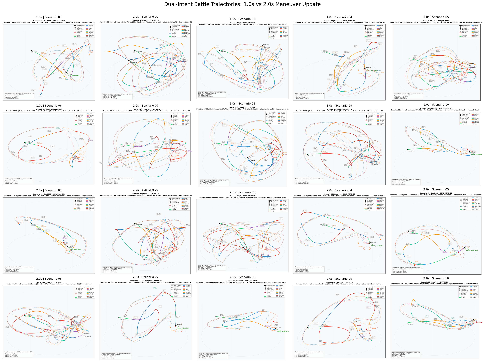
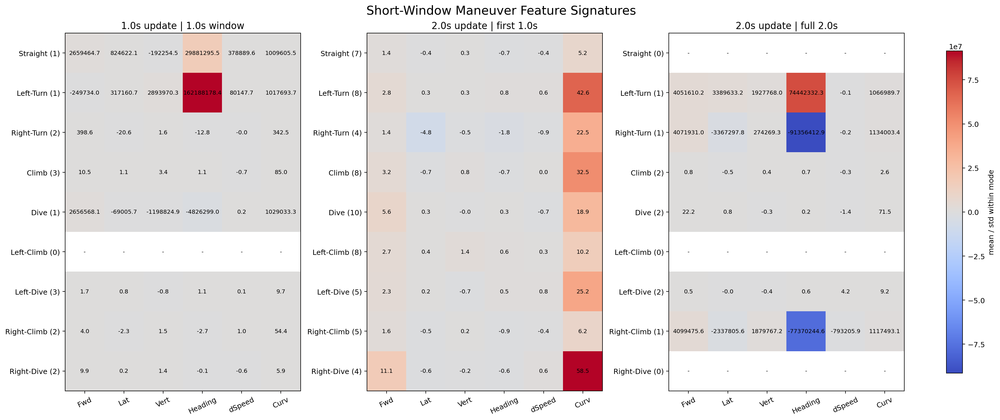
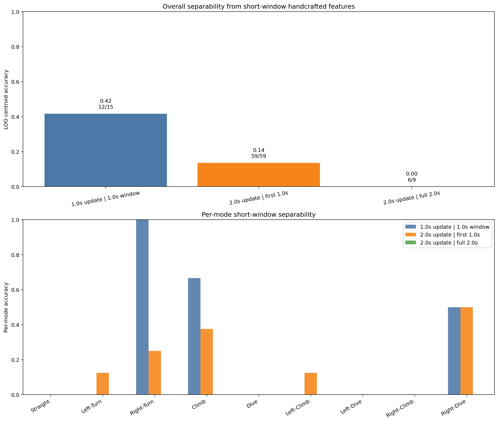
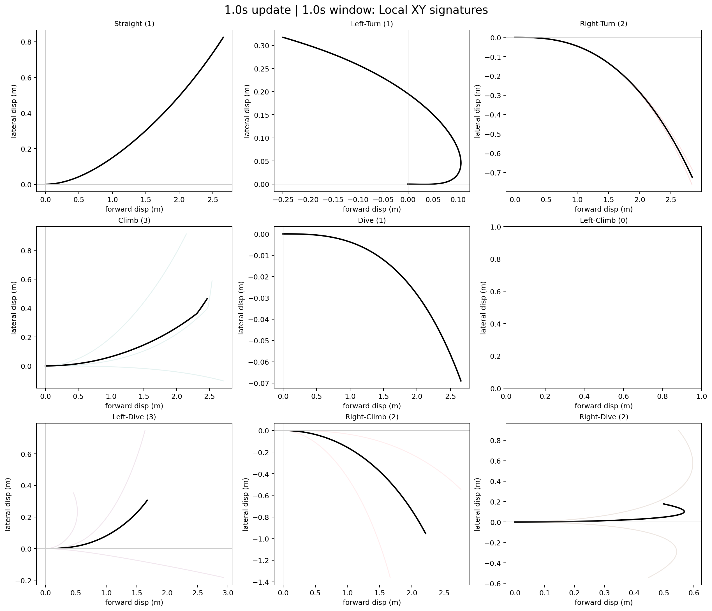
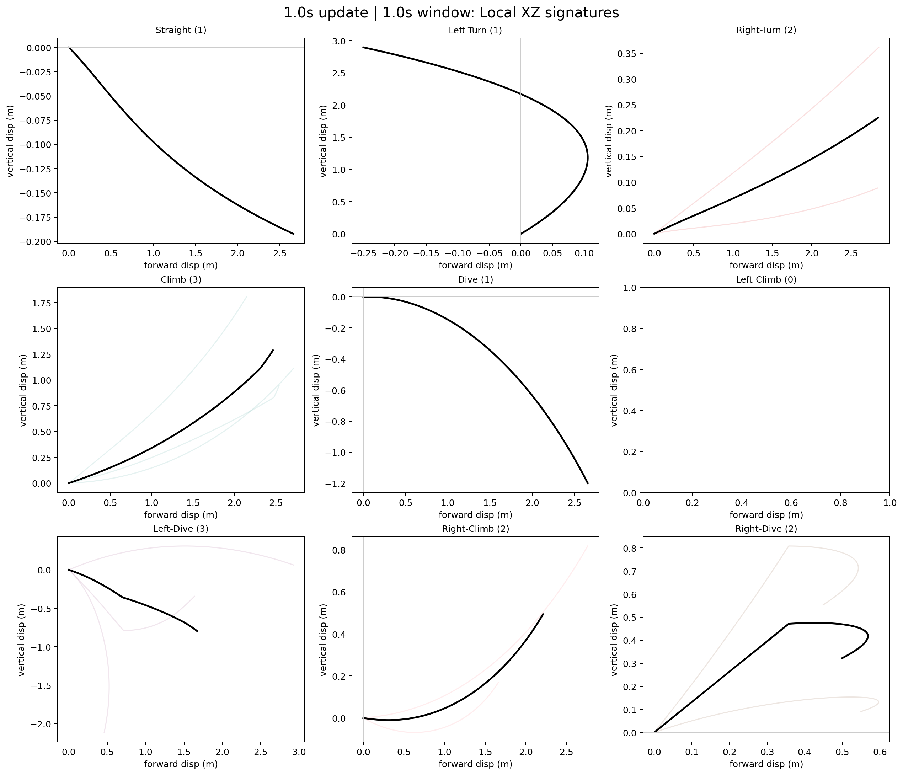
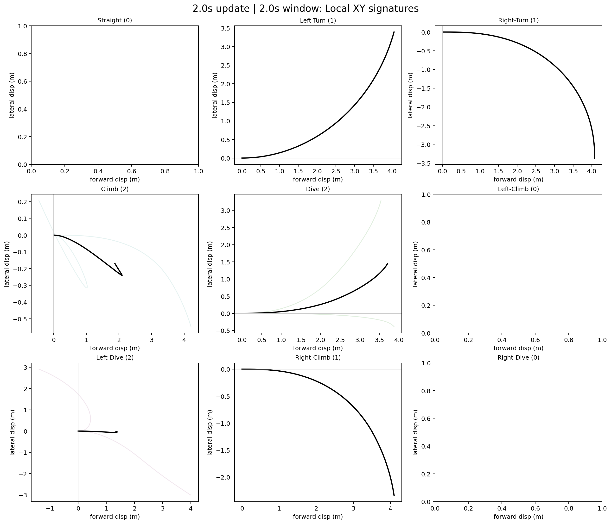
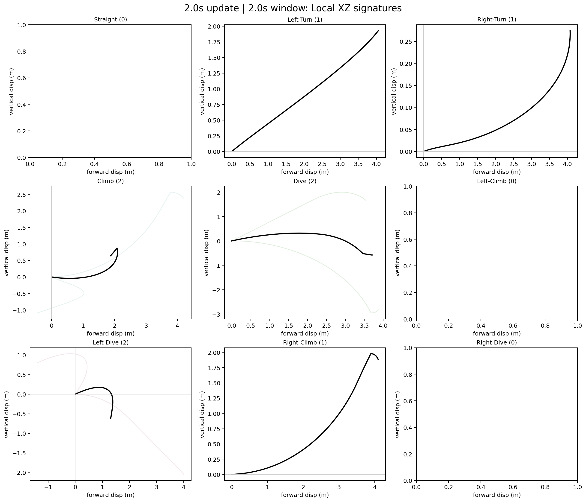

# 双意图 6DoF 短时机动特征分析

## 分析目的

验证在 `dual_intent_6dof_battle` 设定下，当战术意图仍按 `0.5s` 检查不变时，
把机动模式刷新周期从 `1.0s` 改到 `2.0s` 后，目标机在短时窗口内是否能展示出更稳定、可分的机动特征。
这个结论直接关系到后续意图预测器在短历史窗下的分类上限。

本报告对比了两套结果目录：
- `1.0s` 机动刷新：`/data/uavlab/maneuverable-target/results/dual_intent_6dof_battles_1p0s_compare`
- `2.0s` 机动刷新：`/data/uavlab/maneuverable-target/results/dual_intent_6dof_battles_2p0s_compare`

## 关键结论

- 1.0s更新结果整体状态分布为 GOAL_REACHED=3, CAPTURED=2, TIMEOUT=5；2.0s更新结果为 GOAL_REACHED=5, CAPTURED=2, TIMEOUT=3。
- 平均最小交会距离从 0.82 m 变化到 1.22 m，平均机动模式切换次数从 20.4 次降到 8.5 次。
- 基于短窗手工特征的LOO最近质心准确率：1.0s更新@1s=0.42，2.0s更新@前1s=0.14，2.0s更新@完整2s=0.00。
- 完整2.0s纯净机动片段数量偏少，原因是很多 Close_Evade 片段会在 2s 内被战术层提前打断，所以当前数据更适合说明“2s窗口样本稀缺”，不适合单独据此否定 2s 历史窗。

## 双方轨迹总览图

上图按相同 scenario 编号对比了 `1.0s` 和 `2.0s` 两套双方轨迹。
可以直接观察到：`2.0s` 设置下单次 Close_Evade 机动持续更久，目标轨迹局部弯折更完整，追捕方的 PN 追踪轨迹也会出现更明显的响应滞后和包抄重构。

## 结果统计

| 设置 | 状态分布 | 平均时长(s) | 平均最小距离(m) | 平均战术切换次数 | 平均机动模式切换次数 |
| --- | --- | ---: | ---: | ---: | ---: |
| 1.0s刷新 | GOAL_REACHED=3, CAPTURED=2, TIMEOUT=5 | 26.79 | 0.82 | 7.1 | 20.4 |
| 2.0s刷新 | GOAL_REACHED=5, CAPTURED=2, TIMEOUT=3 | 20.08 | 1.22 | 4.8 | 8.5 |

Close_Evade 片段样本数：

- `1.0s` 数据集：{'Left-Turn': 1, 'Straight': 1, 'Dive': 1, 'Right-Dive': 2, 'Right-Climb': 2, 'Left-Dive': 3, 'Climb': 3, 'Right-Turn': 2}
- `2.0s` 数据集：{'Left-Turn': 1, 'Dive': 2, 'Right-Climb': 1, 'Left-Dive': 2, 'Right-Turn': 1, 'Climb': 2}
- 说明：这里的 `2.0s` 数据集只统计了能稳定持续满 `2s` 的纯净机动段，因此样本数会明显少于“前1s窗口”的统计口径。

## 短窗特征签名

热图中的 6 个特征分别是：前向位移、侧向位移、垂向位移、航向变化、速度变化、轨迹曲折度。
每个数值是该模式在对应窗口下的 `均值 / 标准差`，数值越大代表该模式在该特征上的偏向越稳定。

从图上通常可以读出三类现象：
- 左/右转相关模式主要体现在 `侧向位移` 和 `航向变化` 的符号分离。
- 爬升/俯冲相关模式主要体现在 `垂向位移` 的正负分离。
- 组合模式（如 `Left-Climb`、`Right-Dive`）在 `侧向` 和 `垂向` 两个维度同时带符号，通常比纯直行更容易区分。

## 对意图分类的启发式可分性评估

这里没有直接训练分类器，而是用短窗轨迹特征做了一个留一法最近质心分类，
把它当作“这些短时间片本身是否带有可分信息”的近似指标。

- `1.0s刷新 | 1.0s窗口`：整体准确率 0.42，覆盖样本 12/15
- `2.0s刷新 | 前1.0s窗口`：整体准确率 0.14，覆盖样本 59/59
- `2.0s刷新 | 完整2.0s窗口`：整体准确率 0.00，覆盖样本 6/9

需要特别注意：`完整2.0s窗口` 的可用样本非常少，
因为不少机动段在满 2s 之前就被 `0.5s` 战术层检查触发了战术切换，导致纯净 2s 片段不足。
所以这一列更适合作为“当前数据覆盖是否足够”的提醒，而不是最终分类上限的定论。

这组数字可以直接用来指导后续预测器的历史窗长度：
- 如果 `2.0s完整窗口` 明显高于两个 `1.0s窗口`，说明后1秒额外信息很关键，分类器至少应看到 2s 历史。
- 如果 `2.0s前1.0s窗口` 已经接近 `2.0s完整窗口`，说明首秒已足够强，后续模型可以优先优化实时性。
- 如果 `Straight`、`Climb`、`Dive` 这类纯单轴模式准确率明显高，而复合模式偏低，说明未来应加入更细的时序特征而不只是末端位移特征。

## 轨迹局部投影

黑线是同一机动模式下的平均局部轨迹，浅色线是不同 scenario 的样本。
如果某个模式在多个样本中仍能保持相近的弯折方向和垂向趋势，就说明这个模式在短时观测里有比较稳定的“形状签名”。

## 对后续意图预测的建议

1. 训练集组织建议以 `Close_Evade` 进入时刻或机动模式切换时刻作为切窗锚点，而不是简单固定长度滑窗。
2. 若你的目标是尽早分类，先把 `1.0s` 历史窗作为最低可用窗口，再用本报告中的准确率判断是否值得扩展到 `2.0s`。
3. 输入特征不要只喂绝对位置；至少补充速度、局部侧向位移、垂向位移、航向变化率这几类相对量。
4. 如果后续模型要兼顾在线预测和切换检测，可以把“战术层是否进入 Close_Evade”先做成一级门控，再在门控内分类九类机动模式。

